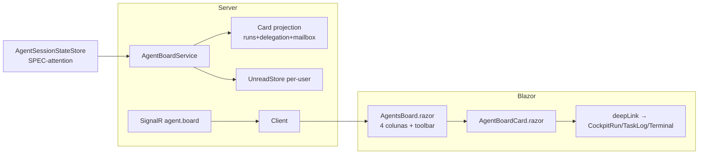

# SPEC-20261020-agent-board-v2: Agents kanban board — rich cards, filters, deep-link, unread

## 0. SPEC Metadata

| Field | Value |
|---|---|
| Feature name | Agents board v2 — kanban de sessões de agente com cards ricos |
| Product / System | agent-harness (Harness) |
| Module / Bounded Context | Blazor (Agents Dashboard) + Application.Contracts + Server + SignalR |
| Change type | Feature |
| Repository | afonsoft/agent-harness |
| Technical owner | afonsoft |
| Suggested branch | `feat/agent-board-v2` |
| Status | `Draft` |
| Depends on | SPEC-20261006 (dashboard columns), SPEC-20261020-agent-attention-model (state source) |
| Reference | Orca `docs/model/agents-sessions` Agent Dashboard; COMPARISON-20261020-orca-delegation-board §3 |

## 1. Executive Summary

### Problem

O Dashboard tab de `/agents` já renderiza as colunas Needs You / Working / Done /
Idle (SPEC-20261006), mas os itens são linhas de lista: sem preview da última
mensagem do agente, sem busca/filtro, sem unread, e o clique não leva ao ponto
exato de atenção. O Kanban GitHub (`/github-board`) também não mostra, no card
da issue, que um agente está trabalhando/travado nela.

### Solution

1. **Agent cards**: card por sessão/run viva com ícone do CLI, título da sessão
   (task title > prompt truncado > `session-<id>`), glyph de estado
   (attention model), preview da última mensagem/evento, idade relativa, badge
   do CLI + repo/worktree + PR/MR linkado, e dot de unread.
2. **Toolbar do board**: busca (sessão, prompt, repo, worktree) + filtros
   multi-select (CLI, status, projeto/repo, com/sem PR) + chips removíveis +
   **Clear all** + toggle **Show idle** (default off, persiste por usuário).
3. **Deep-link**: clique no card abre o run na superfície certa —
   `CockpitRun` para AgentRun, task detail + aba Logs para DelegationTask,
   Terminal page para sessão interativa — e marca o card como lido.
4. **Kanban GitHub enriquecido**: issue cards ganham glyph de estado do agente
   anexado (live run vinculada) + contagem Needs You no header da coluna.
5. **Realtime**: SignalR empurra transições de estado/unread; o board reordena
   e tinta amber (Needs You) / green (Done recente) sem F5.

### Scope

In scope: Agents Dashboard tab rework + CardModel server-side + unread store +
enriquecimento dos issue cards. Out of scope: pop-out em janela separada
(Blazor WASM single-window), kanban drag-drop para mudar estado do agente,
virtualização para >1k cards (paging incremental apenas).

## 2. Requisitos

### Funcionais

- RF-001 `GET /api/agents/board` retorna `AgentBoardSnapshot { columns {
  needsYou[], working[], done[], idle[] }, generatedAtUtc }` onde cada item é
  `AgentBoardCard { id, kind(agentRun|delegationTask|terminalSession),
  cliName, sessionTitle, state, previewText, previewAtUtc, startedAtUtc,
  repoName?, worktreeName?, prUrl?, unread, deepLink }` — mesmo payload que o
  dashboard atual, enriquecido.
- RF-002 `sessionTitle` resolve: `DelegationTask.Title ?? RunSpecDialog name ??
  primeira linha do prompt (80c) ?? AgentRun.Subject ?? session id curto`.
- RF-003 `previewText` = última entrada relevante: último mailbox message body
  (≤160c) > última linha de log não-vazia > `ResultSummary`/`Error` > "—".
  Conteúdo de transcripts de CLI **nunca** é lido (privacidade — ver
  CliDatabaseMap denied-tables); preview vem só de logs/mailbox do Harness.
- RF-004 Board toolbar: `?q=` busca em sessionTitle/cli/repo/worktree/preview;
  filtros `cli`, `state`, `repo`, `hasPr`; estado persistido em query-string
  (deep-link do board filtrado).
- RF-005 Toggle **Show idle agents**: default esconde a coluna Idle (mantém
  count no header); preferência salva em `UserSettings` por usuário.
- RF-006 Clique no card → navega `deepLink` e chama `POST
  /api/agents/board/cards/{id}/read` (marca unread=false, broadcast SignalR
  `agent.board.read` para outras abas).
- RF-007 Unread: vira `true` em transições `worker_done`, `escalation`,
  `decision`/`question` nova, `blocked`; zera ao abrir o card. Badge no item
  de menu "Agents" = soma de unread (SPEC-20261020-agents-feed-notifications
  compartilha o store).
- RF-008 Needs You cards: fundo amber + resumo da pergunta/decisão pendente no
  card; Done <15min: fundo green; demais neutros.
- RF-009 GitHub Kanban: `KanbanBoard` consulta runs vivas por `issueId`
  (endpoint existente de runs) e pinta glyph de estado + spinner no card;
  coluna com itens Needs You ganha badge de contagem no header.
- RF-010 Ordenação: Needs You por `previewAtUtc` desc; Working por
  `startedAtUtc` asc (mais antigo primeiro); Done/Idle por `finishedAtUtc`/
  `previewAtUtc` desc. Idle >30min sem heartbeat pode ser colapsado em
  `+N idle` quando `Show idle` off.
- RF-011 Empty states por coluna com ação contextual ("Delegate from AI Code
  chat" link quando Needs You vazio).
- RF-012 Board respeita permissões atuais (authorize como Agents page) e não
  expõe cards de escopos que o usuário não pode ver.

### Não-funcionais

- Snapshot do board em uma query EF (projection, sem N+1); payload ≤256KB para
  200 cards; `If-Modified-Since`/etag opcional no poll de fallback.
- SignalR `agent.board` group: transições de estado disparam patch incremental
  (cardId + campos mudados), não re-fetch total.
- Cards 100% teclado-navegáveis (tab order por coluna, Enter abre, setas entre
  colunas), `aria-live="polite"` nas transições de coluna.
- Preferência `Show idle` round-trip <50ms (cache client + write-through).

## 3. Arquitetura

- `AgentBoardService` (Application) projeta cards de `AgentRun` +
  `DelegationTask` + `AgentMailboxMessage` + terminal sessions registradas.
- `UnreadStore` em tabela `AgentBoardReadMarkers(userId, cardId, readAtUtc)` —
  unread deriva de `event.AtUtc > readAtUtc`.
- `AgentBoardCard.razor` novo; colunas reutilizam markup do dashboard atual.
- Glyph/colors: mesmo mapa de `AgentStateChip` (reusar component).

## 4. Fases

- **P1** — CardModel + endpoint + `AgentBoardCard` + colunas + deep-link +
  tintas Needs You/Done.
- **P2** — unread store + badge no menu + SignalR patch + read endpoint.
- **P3** — toolbar busca/filtros/query-string + Show idle + empty states +
  enriquecimento KanbanBoard (glyph + badge coluna).

## 5. Testes

- Unit: projeção de card por kind (run/task/terminal), sessionTitle fallback
  chain, preview precedence mailbox>log>summary, ordenação por coluna.
- Unit: unread derivado de readAtUtc; read endpoint idempotente.
- Integration: `GET /api/agents/board` 200 com 4 colunas; filtro `?cli=codex`
  restringe; `POST .../read` zera badge; permissão 403 em escopo alheio.
- UI guard: card foca com Enter; `aria-live` anuncia mudança de coluna;
  idle toggle persiste após reload.

## 6. Open questions

1. `kind=terminalSession` (Terminal page interativa) entra em P1 ou fica fora
   até o attention model cobrir sessões interativas? Proposta: P3.
2. Preview de log de run trunca ANSI? Proposta: strip ANSI + collapse
   whitespace no servidor, nunca renderizar raw escapes.
3. Board vira a aba default de `/agents`? Proposta: sim, mantendo
   `?tab=dashboard` como id da aba.
