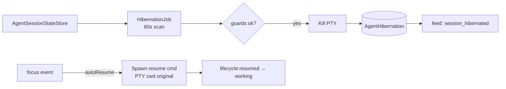

# SPEC-20261020-agent-hibernation: auto-pause done+idle sessions, resume on focus via native --resume

## 0. SPEC Metadata

| Field | Value |
|---|---|
| Feature name | Agent hibernation — pausar/retomar sessões done+idle |
| Product / System | agent-harness (Harness) |
| Module / Bounded Context | Application (lifecycle job) + Integrations (per-CLI resume) + Blazor (session card state) |
| Change type | Feature |
| Repository | afonsoft/agent-harness |
| Technical owner | afonsoft |
| Suggested branch | `feat/agent-hibernation` |
| Status | `Draft` |
| Depends on | SPEC-20261020-agent-attention-model (`done`/`idle` states, `agent.idle_timeout` event), SPEC-20261020-session-history-parity (ResumeCommand por sessão) |
| Reference | Orca `docs/hibernation`; COMPARISON-20261020-orca-delegation-board §3 |

## 1. Executive Summary

### Problem

Sessões de CLI ficam abertas consumindo memória/PTY depois de terminar o
trabalho. Hoje ou o usuário mata manualmente ou o processo fica vivo
indefinidamente. Orca resolve com hibernação: sessão `done`+`idle` por
≥30min é pausada (processo morto, PTY liberado, transcript preservado), e
retomada transparente via `--resume` nativo do CLI quando o usuário foca
o card.

### Solution

`AgentHibernationService` — job que varre `AgentSessionState` a cada 60s:

- **Hibernate** quando: `state=done` (ou `idle`+`done` anterior) E
  `idleFor ≥ IdleThreshold` (default 30min, configurável por usuário) E
  `cli.supportsResume=true` E nenhum guard ativo.
- **Guards** (nunca hibernar): dispatch unsettled (`delegate_task` rodando),
  `waiting_you`/`blocked` (pergunta pendente), sub-agent vivo no run,
  `manuallyPinned` pelo usuário.
- **Resume on focus**: usuário abre card da sessão hibernada → backend
  executa `ResumeCommand` (claude `--resume <id>`, codex `resume <id>`,
  opencode `--session <id>`) em PTY novo com `cwd` original →
  `state=working` (primeiro sinal do attention model).
- **Card hibernated**: glyph `zzz` + "Hibernated <age> ago" + ação
  `Resume` (ou auto-resume on focus — preferência).

### Scope

In scope: hibernação de sessões de terminal/run locais com suporte a resume
nativo; guards; manual hibernate/resume; preferência de threshold. Out of
scope: hibernar processo com estado de kernel não serializável (usar kill +
resume cmd, não checkpoint), sessões de CLIs sem resume (devin-cli,
antigravity — `supportsResume=false` → nunca hibernam, só aparecem `idle`).

## 2. Requisitos

### Funcionais

- RF-001 `AgentHibernation` entity: `SessionKey`, `Cli`, `HibernatedAtUtc`,
  `IdleAtUtc`, `ResumeCommand`, `Cwd`, `AutoResumedCount`, `Pinned`.
- RF-002 Job `AgentHibernationJob` (IBackgroundJob, interval 60s): scan
  `AgentSessionState` → candidatos → hibernate via
  `ITerminalSessionManager.Kill(sessionKey)` + marca `hibernated=true`;
  emite feed item `session_hibernated`.
- RF-003 Guards avaliados por `IAgentHibernationGuard` (chain): dispatch
  unsettled, attention `waiting_you|blocked`, run com sub-agents vivos,
  `Pinned`, `supportsResume=false` → retorna `false` com `reason` (exposta
  no card como tooltip "not hibernating: <reason>").
- RF-004 `AgentCliResumeSupport` registry por `AgentCliKind`:
  `{supportsResume, resumeCmdTemplate}` — claude/codex/opencode/gemini true;
  devin/antigravity false; desconhecido → false (conservador).
- RF-005 `POST /api/agents/sessions/{key}/hibernate` (manual) — mesma
  pipeline do job, ignora threshold mas respeita guards;
  `POST .../resume` — kill garante idempotente (se já morto, só spawna).
- RF-006 Auto-resume on focus: `POST .../focus` com `hibernated=true` →
  se `UserSettings.autoResumeOnFocus=true` executa resume; senão retorna
  `{resumable:true}` e UI mostra botão.
- RF-007 Resume spawn: PTY novo, `cwd` original, env `HARNESS_RESUMED=1` +
  `HARNESS_RESUME_OF=<sessionKey>`; attention model recebe sinal
  `lifecycle:resumed` → `working` até primeira transição.
- RF-008 Card no board/feed: glyph hibernated + "Resume" action; Needs You
  nunca contém hibernated (hibernate só após done/idle).
- RF-009 `Pinned`: toggle no session menu "Keep alive" → `Pinned=true` no
  store; hibernate ignora pinned.
- RF-010 `IdleThreshold` em `UserSettings.agentIdleThresholdMinutes`
  (default 30, min 5, max 1440); change aplica no próximo tick.

### Não-funcionais

- Kill é graceful (SIGTERM → 5s → SIGKILL); PTY/liberação confirmada antes
  de marcar hibernated.
- Resume falha (cmd exit≠0 ou timeout 30s) → `state=blocked` com
  `resume_failed` reason + feed item; nunca retry-loop automático.
- Scan não segura locks; candidatos avaliados em batch ≤50/tick.
- Hibernated não aparece como "alive" no `worktree ps` equivalente
  (`AgentBoardService`).

## 3. Arquitetura

- `AgentHibernationService` (Application): pipeline hibernate/resume.
- `IAgentHibernationGuard` chain em Application (testável).
- Resume spawn via `ITerminalSessionManager` existente (mesma surface que
  `Resume` manual da aba Sessions).

## 4. Fases

- **P1** — entity+registry+job básico + guards dispatch/attention + manual
  hibernate/resume + card glyph.
- **P2** — auto-resume on focus + Pinned + threshold por usuário +
  feed items.
- **P3** — `supportsResume` por todos os CLIs do registry + métricas
  (hibernated count, auto-resumed, saved MB estimado).

## 5. Testes

- Unit: guard chain (cada guard individual + composição); threshold
  boundary; `supportsResume=false` nunca hiberna.
- Unit: resume command por CLI (templates corretos); env vars.
- Integration: hibernate→feed→card glyph→manual resume→state working;
  resume falho → blocked + feed.
- Integration: pinned não hiberna; threshold change respeitado no tick.

## 6. Open questions

1. Hibernar sessões de `delegate_task` quando dispatch já `settled` mas run
   ainda aberto? Proposta: sim (guard só checa *dispatch unsettled* — run
   aberto sem dispatch ativo pode hibernar).
2. Auto-resume deve restaurar scrollback? Proposta: não v1 (PTY novo,
   scrollback do arquivo de transcript via "Open log" se precisar).
3. Memória economizada visível? Proposta: `GET /api/agents/hibernation/
   stats` → `{hibernatedCount, estimatedRssSaved}` (heurística por CLI).
