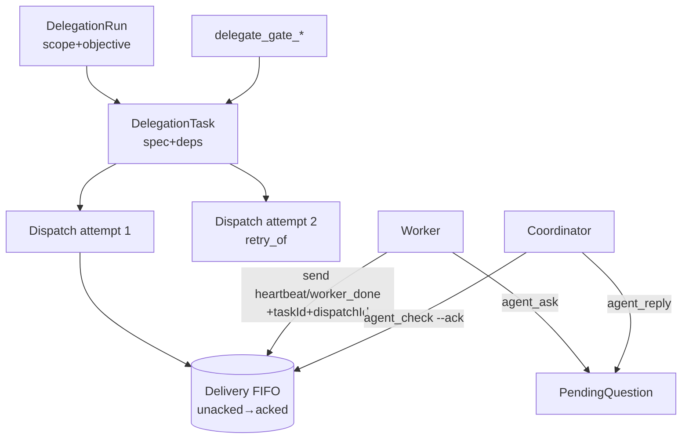

# SPEC-20261020-orchestration-contract-v2: Run/Dispatch split, deliveries+acks, ask/reply, gates, launch prefs

## 0. SPEC Metadata

| Field | Value |
|---|---|
| Feature name | Orchestration contract v2 — paridade com Orca runs/tasks/dispatches |
| Product / System | agent-harness (Harness) |
| Module / Bounded Context | Domain (Delegation) + Application + Integrations (chat/MCP tools) + Server |
| Change type | Feature |
| Repository | afonsoft/agent-harness |
| Technical owner | afonsoft |
| Suggested branch | `feat/orchestration-contract-v2` |
| Status | `Draft` |
| Depends on | DelegationTask/AgentMailboxMessage existentes; SPEC-20261020-agent-attention-model para estados |
| Reference | Orca `docs/cli/orchestration` + `skill-guides/orchestration/references/*`; COMPARISON-20261020-orca-delegation-board §2 |

## 1. Executive Summary

### Problem

Nossa delegação cobre o caminho feliz (plan/task/fanout/status/compare/mailbox/
decide), mas o contrato de entrega é fraco: `agent_inbox` marca lido na leitura
(at-most-once), não há tentativa (attempt) separada do task — `retry_of` cria
task nova em vez de novo attempt —, não existe pergunta bloqueante
worker→coordenador (só humano via `agent_decide`), gates não são ligados a task,
não há lifecycle pós-settle (release/retain/read de output arquivado) e nenhum
override de modelo/esforço por worker.

### Solution

Evoluir o modelo para a forma Orca, mantendo nossos nomes/tools:

1. **DelegationRun** — namespace durável por coordenação (já temos `Scope`;
   formalizamos `Run { id, scope, objective, status, coordinatorKey }`).
2. **Dispatch** — attempt de uma DelegationTask: `Dispatch { id, taskId,
   workerKey, attempt, state(pending|dispatched|settled|released|retained|
   abandoned), preambleJson, terminalHandle? }`. Task vira spec+deps;
   Dispatch é a autoridade de `worker_done`/heartbeat (`--dispatch-id` já
   existe em mails — vira campo de primeira classe).
3. **Deliveries + ack**: mailbox vira fila FIFO com `Delivery { id, runId,
   messageIds≤50, ackedAtUtc? }`; `agent_inbox` vira `check` que retorna a
   mais antiga não-ack e repete até `check --ack <deliveryId>`; `--peek`/
   `--all` não consomem. Lêdo ≠ entregue.
4. **Ask/reply**: `agent_ask` bloqueante para workers → retorna `messageId`;
   timeout → `agent_ask --resume <messageId>`; coordenador responde com
   `agent_reply <messageId> <answer>`. (Humano continua via `agent_decide`.)
5. **Task-bound gates**: `delegate_gate_create {taskId, question, options[]}`
   bloqueia task até `delegate_gate_resolve`; gates listáveis por task.
6. **Dispatch lifecycle**: `delegate_worker_show/read/release/retain/
   abandon` — release arquiva output e libera o worker; retain mantém vivo
   para follow-up; read lê output arquivado (≤N linhas); retry =
   `delegate_task --retry_of <dispatchId>` criando attempt+1 no mesmo task.
7. **Launch prefs**: `delegate_task`/`delegate_plan` aceitam `model`, `effort`;
   receipt inclui `launch.requested` vs `launch.effective` (adaptador resolve
   por CLI; desconhecido → erro explícito, nunca silencia).
8. **Group addresses** no mailbox: `@all @idle @<cli> @worktree:<id>` —
   mensagens de lifecycle nunca para grupos.

### Scope

In scope: entidades Run/Dispatch/Delivery/Gate, tools atualizadas +
`delegate_worker_*` + `agent_ask/reply`, migração EF, compat shim para payloads
antigos de `worker_done` sem dispatchId. Out of scope: workers federados
(`--on host` — P3 posterior), nested depth >1, terminal-reuse cross-task.

## 2. Requisitos

### Funcionais

- RF-001 `DelegationRun` entity: `Id`, `Scope`, `Objective`, `Status
  (open|settled|aborted)`, `CoordinatorKey`, `CreatedAtUtc`. Todo
  `delegate_plan/task/fanout` cria/usa run do scope corrente; `delegate_run_show
  --id` expõe `{objective,tasks[],openDispatches,unackedDeliveries}`.
- RF-002 `Dispatch` entity: `Id`, `TaskId`, `WorkerKey`, `Attempt` (≥1),
  `State`, `PreambleJson` (task spec + ids + mailbox addr + contract text),
  `CreatedAtUtc`, `SettledAtUtc`. Completion authority = dispatchId + taskId
  juntos; `worker_done` com dispatchId inexistente/stale → `stale_dispatch`
  error sem transição.
- RF-003 `Delivery` entity: `Id`, `RunId`, `MessagesJson` (≤50 ids),
  `CreatedAtUtc`, `AckedAtUtc?`. `agent_check [--wait --types ...] [--ack id]
  [--peek|--all]`: sem ack → retorna oldest unacked (replay); com ack → marca
  e retorna a próxima; `--wait` com heartbeat a 15s; timeout → delivery vazia.
- RF-004 `agent_ask {question, options?, timeoutMs}` → pendente até
  `agent_reply` ou timeout; `--resume <messageId>` re-bloqueia na mesma
  pergunta sem duplicar; reply fora do ciclo → `question_not_pending`.
- RF-005 `delegate_gate_create {taskId, question, options[]}` → task fica
  `blocked` até `delegate_gate_resolve {gateId, resolution}`; `gate-list
  --task` lista abertas/resolvidas; resolver desbloqueia deps avaliando DAG.
- RF-006 Lifecycle tools: `delegate_worker_show --dispatch` (state, attempt,
  preamble, terminal), `delegate_worker_read --dispatch --limit` (output
  arquivado — sobrevive a release), `delegate_worker_release` (archive +
  cleanup worker), `delegate_worker_retain`, `delegate_worker_abandon`.
- RF-007 `retry_of` aponta para Dispatch (não task): cria `Dispatch.Attempt+1`
  no mesmo `TaskId`, herdando worktree/task; `--retry_of` não herda
  `--on/worktree` (explícito).
- RF-008 `delegate_task`/`delegate_plan`: `model`, `effort` opcionais por
  item; adapter `IAgentAdapter.ResolveLaunch(cli, model, effort)` retorna
  `{effectiveModel?, effectiveEffort?, args[]}`; CLI sem suporte → erro
  `launch_preference_unsupported` antes de criar dispatch.
- RF-009 Group addresses: `agent_send --to @all|@idle|@<cli>|@worktree:<id>`
  fan-out para dispatch mailboxes do run do remetente; `worker_done`,
  `heartbeat`, `decision` com `--to` grupo → rejeitado.
- RF-010 `delegate_task_update --id --status blocked --result <json>` para
  marcar task externamente travada com razão estruturada; `delegate_reset
  --tasks|--messages|--all` limpa estado do run (guarded: recusa com
  dispatches ativos fora de `--force`).

### Não-funcionais

- Migração EF reversível: `DelegationTasks` ganha `RunId`+`ActiveDispatchId`;
  `AgentMailboxMessages` ganha `DeliveryId`; dados antigos → run legado
  `run-legacy` + delivery única acked (sem replay de histórico).
- Delivery dispatch ≤50 mensagens/batch (constante); `check` resposta ≤64KB.
- `agent_check --wait` não segura lock; poll interno 1s + heartbeat stderr 15s.
- Compat: tools antigos (`agent_inbox`, `agent_send`) viram shims sobre
  check/send por ≥2 releases, marcados `deprecated` no schema.

## 3. Arquitetura

- Domain: `DelegationRun`, `Dispatch`, `Delivery`, `PendingQuestion`,
  `DelegationGate` + repos EF.
- Application: `DelegationOrchestrationService` evolui — enqueue de dispatch,
  readiness por deps (ready wave), settlement idempotente por dispatchId.
- Tools: `delegate_run_show`, `delegate_task_update`, `delegate_reset`,
  `delegate_worker_{show,read,release,retain,abandon}`,
  `delegate_gate_{create,resolve,list}`, `agent_check`, `agent_ask`,
  `agent_reply`; shims dos antigos.
- `DelegationToolSupport` valida `--dispatch-id`/`--task-id` pareados contra
  dispatch ativo (completion authority).

## 4. Fases

- **P1** — Run+Dispatch+Delivery entities/migration, check/ack, completion
  authority por dispatchId, retry_of→attempt.
- **P2** — ask/reply + gates + task_update blocked + group addresses.
- **P3** — worker lifecycle (release/retain/read/abandon) + launch prefs +
  reset + shims/deprecations.

## 5. Testes

- Unit: readiness por deps (dep failed → task blocked, não ready); dispatchId
  stale rejeita worker_done; delivery replay até ack; ask resume sem dup;
  gate bloqueia/desbloqueia; group address exclui remetente não-membro.
- Unit: launch pref resolve (claude model ok; CLI sem flag → erro).
- Integration: migração legacy→v2 preserva tasks/mails; check FIFO ≤50 com
  ack parcial; worker lifecycle release→read ainda retorna output.
- Integration: `delegate_plan` com deps cria run único, fanout group intacto.

## 6. Open questions

1. `Dispatch` expõe `TerminalHandle` para reuse cross-task (Orca
   `--terminal`)? Proposta: P3 — `delegate_task --terminal <workerKey>` só
   quando mesma CLI + mesmo worktree.
2. Run scope hoje = conversation id; aceitar `--run <id>` explícito para
   coordenação multi-conversation? Proposta: sim, mas recusado sem membership.
3. Retained worker vira recurso faturável no FinOps? Proposta: sim —
   `dispatch.state=retained` conta no usage breakdown até release.
