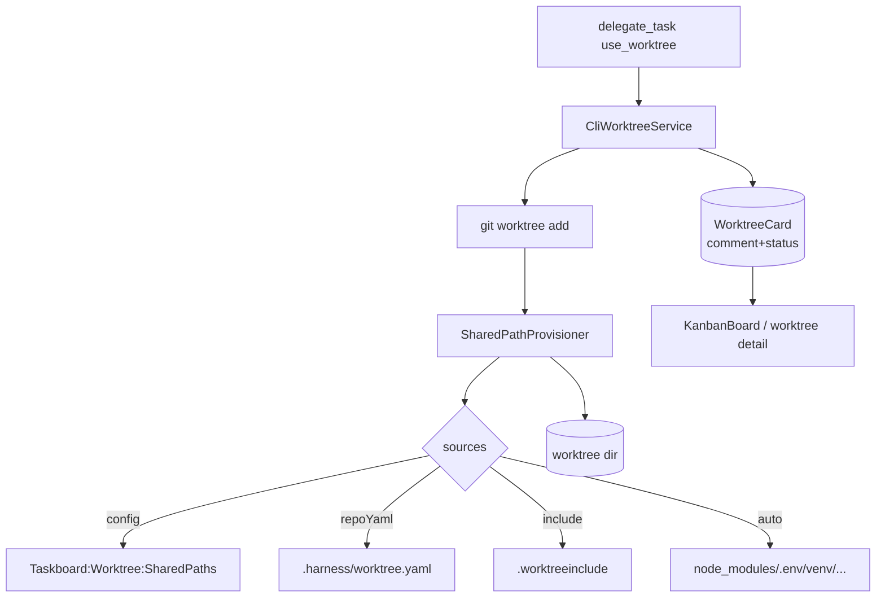

# SPEC-20261020-worktree-shared-context: gitignored shared dirs/files into worktrees + card comment/status checkpoint

## 0. SPEC Metadata

| Field | Value |
|---|---|
| Feature name | Worktree shared context — dirs/arquivos ignorados + status comment por card |
| Product / System | agent-harness (Harness) |
| Module / Bounded Context | Integrations (worktree provisioning) + Application + Blazor (KanbanBoard card, worktree detail) |
| Change type | Feature |
| Repository | afonsoft/agent-harness |
| Technical owner | afonsoft |
| Suggested branch | `feat/worktree-shared-context` |
| Status | `Draft` |
| Depends on | `use_worktree` existente em `delegate_task`; `CliWorktreeService` |
| Reference | Orca `docs/model/worktrees` (shared dirs/files via Settings + `orca.yaml` + `.worktreeinclude`) + `docs/cli/worktree-checkpoints` (`worktree set --comment --workspace-status`); COMPARISON-20261020-orca-delegation-board §1/§3 |

## 1. Executive Summary

### Problem

`delegate_task use_worktree=true` cria worktree limpa, mas: (a) `node_modules`,
`.env`, `bin/`, dados de seed e outros paths gitignored ficam vazios — worker
perde tempo re-instalando ou falha por falta de contexto; (b) o card da
worktree no board não tem lugar para o humano registrar *por que* aquele
worktree existe/status atual — a informação vive no chat da task, fora do
card.

### Solution

1. **Shared context provisioning**: declaração de paths gitignored que são
   copiados/symlinkados para cada worktree novo:
   - **Fontes** (ordem de precedência): `Taskboard:Worktree:SharedPaths` em
     config global → `.harness/worktree.yaml` no repo → `.worktreeinclude`
     (um path por linha, gitignore-syntax) → auto-detect (`node_modules`,
     `.env`, `venv`, `bin/`, `obj/`, `.next`).
   - **Modo** por path: `copy` (default — snapshot no provisionamento),
     `symlink` (compartilhado — cuidado com mutações), `skip`.
   - Executado por `CliWorktreeService.PrepareWorktree` após `git worktree add`.
2. **Card comment/status**: `WorktreeCard { WorktreePath, Comment?,
   WorkspaceStatus(clean|dirty|conflict|unknown), StatusCommentedAtUtc }` —
   set via MCP `worktree_set_status` ou UI; renderizado no card da worktree
   (sidebar/KanbanBoard) como linha de comentário + badge de status do git.

### Scope

In scope: provisioning de shared paths nos 3 modos + comment/status no card
+ tool `worktree_set_status`. Out of scope: sync contínuo (só no add),
worktree templates por repo (P4), `.worktreeinclude` em nested worktrees.

## 2. Requisitos

### Funcionais

- RF-001 `WorktreeSharedPath` (Domain.Shared VO): `Path` (relativo),
  `Mode(copy|symlink|skip)`, `Source(config|repoYaml|include|auto)`.
- RF-002 `CliWorktreeService.PrepareWorktree(worktreePath, repoPath)`:
  resolve shared paths (merge de fontes, precedência config>repoYaml>
  include>auto) → aplica:
  - `copy`: `cp -a src dst` (preserva perms); path inexistente → skip silencioso.
  - `symlink`: `ln -s` relativo; existente → skip (nunca sobrescreve).
  - Path traversal (`..`, absoluto) → `invalid_shared_path` error.
- RF-003 `.harness/worktree.yaml` schema: `shared: [{path, mode?}]` +
  `exclude: [path]` (exclude vence sobre shared/auto).
- RF-004 `.worktreeinclude`: um path por linha, `#` comentário, `!path` negation;
  parse mesmo motor gitignore-style (reutilizar parser existente ou `Ignore`
  NuGet se já presente).
- RF-005 Auto-detect: se nenhuma fonte declara `node_modules|.env|venv|bin|obj`,
  verificar existência no repo raiz e incluir como `copy` — loga
  `auto_detected_shared_paths` no preamble do dispatch.
- RF-006 `WorktreeCard` entity: `WorktreePath`, `RepoPath`, `Comment?` (≤500c),
  `WorkspaceStatus`, `StatusCommentedAtUtc`, `TaskId?` — atualizado por
  `worktree_set_status` tool ou `PATCH /api/worktrees/{path}/card`.
- RF-007 `worktree_set_status` tool (Integrations/Chat/Tools): args
  `{worktreePath, comment?, status?}`; status `clean|dirty|conflict|unknown`
  — `unknown`/`null` faz `git status --porcelain` on-demand para derivar.
- RF-008 Card UI: worktree detail + KanbanBoard card mostram `Comment`
  (última linha, tooltip full) + `WorkspaceStatus` badge (clean=green,
  dirty=amber, conflict=red); atualiza via SignalR `worktree.card` patch.
- RF-009 `delegate_task` preamble inclui `sharedPathsApplied[]` para o worker
  saber o que já existe (evita re-`npm install` no `node_modules` copiado).
- RF-010 `worktree_status` tool retorna `sharedPaths[]` + `card` além do git
  status atual.

### Não-funcionais

- Shared paths ≤50 por worktree; copy assíncrona em background (não bloqueia
  `worktree add` retorno — task fica `provisioning` até terminar).
- `node_modules` copy usa `cp -a` com `--reflink=auto` quando btrfs/xfs
  (fallback plain copy); size guard >2GB → log warning + pede confirmação
  via `agent_decide` se interativo, senão `skip`.
- Nunca copiar `.env` para worktree quando `Taskboard:Worktree:BlockSecrets=true`
  (default false — usuário assume).
- Parse de `.harness/worktree.yaml` via `YamlDotNet` (já no repo para
  automations) — schema validado, erro → log + skip file.

## 3. Arquitetura

- `SharedPathProvisioner` (Integrations) — resolve+aplica, testável com fs
  fake.
- `WorktreeCard` (Domain) + EF migration; service em Application.
- Tool `worktree_set_status` segue padrão `DelegationToolSupport`.

## 4. Fases

- **P1** — provisioner com `.worktreeinclude` + auto-detect + copy/symlink +
  preamble `sharedPathsApplied`.
- **P2** — `.harness/worktree.yaml` + config global + `worktree_set_status`
  tool + `WorktreeCard` entity + SignalR patch.
- **P3** — card UI (comment+status badge) + `worktree_status` enriquecido +
  size guard + secrets block.

## 5. Testes

- Unit: precedência de fontes (config vence repoYaml vence include vence auto);
  exclude em `.harness/worktree.yaml` vence shared; `..`/`/abs` rejeitado.
- Unit: copy vs symlink — existente nunca sobrescreve; auto-detect não
  duplica quando já declarado.
- Unit: `worktree_set_status` deriva `clean|dirty` via git status parser
  (fixtures de `--porcelain` output).
- Integration: provision aplica paths; preamble lista; card comment patch
  SignalR; secrets block impede `.env` copy.

## 6. Open questions

1. `symlink` para `node_modules` vs `copy`? Proposta: default `copy`
   (isolamento — worktree pode mudar package-lock; symlink compartilha
   o install entre worktrees e pode corromper). `symlink` opt-in explícito.
2. `.env` deve ser auto-detectado? Proposta: sim mas como `skip` por default
   (não copiar) — usuário opta via `.harness/worktree.yaml` `{path: .env,
   mode: copy}` quando quiser.
3. Comment deve replicar pro `issue` do GitHub quando worktree vinculado?
   Proposta: P4 — `worktree_set_status --propagate` posta comment no issue.
