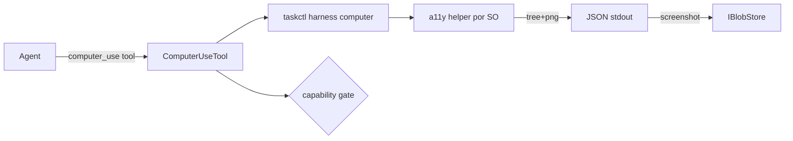

# SPEC-20261021-computer-use: controle de apps nativos via accessibility tree

## 0. SPEC Metadata

| Field | Value |
|---|---|
| Feature name | Computer use — agentes operam apps desktop via a11y tree |
| Product / System | agent-harness (Harness) |
| Module / Bounded Context | Integrations (`harness computer` CLI + tool) + Server + Domain.Shared (capabilities) |
| Change type | Feature |
| Repository | afonsoft/agent-harness |
| Technical owner | afonsoft |
| Suggested branch | `feat/computer-use` |
| Status | `Draft` |
| Depends on | `browser_use` existente (análogo web), `IChatTool`/`IProcessRunner`, capability gating |
| Reference | Orca `docs/cli/computer-use` (`orca computer`: list-apps, get-app-state, click/set-value/type/scroll/screenshot por a11y tree, `--value-stdin`); README "Compared to Orca" gap ⑩ |

## 1. Executive Summary

### Problem

`browser_use` cobre a web; nada cobre o **desktop** — agente que precisa
clicar num instalador nativo, ler uma janela de IDE ou operar um app sem
API fica travado. A alternativa (screenshot+coords cruas) é frágil e sem
verificação.

### Solution

`harness computer` (sub-CLI em `taskctl` + tool `computer_use` para
agentes) com o loop Orca: `list-apps` → `get-app-state` (a11y tree +
screenshot) → ação semântica (`click`/`set-value`/`press-key`/…) por
`element-index` → re-snapshot para verificar. Backend por plataforma:
Linux `AT-SPI` (via `gdbus`/python-atspi bridge), macOS `AX` (helper
swift), Windows `UIA` (helper .NET) — o host só declara `supported` onde
o helper existe.

### Scope

In scope: CLI + tool + snapshot/ações core + screenshots + Linux backend
(AT-SPI) primeiro. Out of scope: recording de fluxos, OCR de fallback
quando a11y vazio, mobile/desktop remoto (host-target entra com
remote-hosts), ações destrutivas sem gate (vão pelo capability/approval
flow existente).

## 2. Requisitos

### Funcionais

- RF-001 `harness computer` subcommands: `permissions`, `capabilities`,
  `list-apps`, `list-windows --app`, `get-app-state --app [--window-id]
  [--no-screenshot]`, `click|set-value|type-text|press-key|hotkey|
  paste-text|scroll|drag|perform-secondary-action --app --element-index|
  --x/--y`, `--value-stdin`/`--text-stdin` para secrets.
- RF-002 Tool `computer_use` (Integrations/Chat/Tools): espelha o CLI com
  `action` + args; capability `agent:computer_use` + gate de aprovação
  para ações mutáveis (`click`, `type-text`, `drag` → `needs_approval`
  por default; `get-app-state`/`list-*` read-only).
- RF-003 Element index: escopo ao último `get-app-state` (sparse); tool
  retorna `snapshotId` — ação com `snapshotId` velho → `stale_snapshot`
  (força re-snapshot, mesmo contrato Orca).
- RF-004 `get-app-state` → `{tree: [...], elementCount, screenshot.path}`
  — screenshot gravado via `IBlobStore` (SPEC-artifact-store) com
  `Kind=screenshot`; `--no-screenshot` pula.
- RF-005 Secrets: `set-value`/`type-text`/`paste-text` aceitam
  `--value-stdin`/`--text-stdin` (nunca em args de linha — fora do
  shell history e do prompt log).
- RF-006 Permissions probe: `permissions` reporta o que falta por SO
  (Linux: AT-SPI bus ativo; macOS: Accessibility+Screen Recording;
  Windows: UIA disponível) — tool retorna guia de fix antes de operar.
- RF-007 Capability matrix: `computer_use` entra em `CliCapabilityMatrix`
  como tier `ComputerUse` (Supported onde o helper existe).

### Não-funcionais

- Helper por SO roda fora do processo server (`IProcessRunner` → binário
  dedicado) — crash de a11y não derruba o server; timeout 10s por ação.
- Sem a11y → não cai para pixel-click silencioso: retorna
  `a11y_unavailable` + hint de coords opcionais (`--x/--y` é opt-in).
- Screenshot ≤2MB; tree truncado a 4k elementos (`treeTruncated: true`).
- Actions auditadas: `computer_use` mutável grava `AgentRunEvent`
  `computer_action` com app+element+result.

## 3. Arquitetura

- `IComputerUseBackend` (Contracts) — `AtSpiBackend` (Linux P1),
  `AxHelper`/`UiaHelper` stubs documentados.
- Snapshot state em memória por `snapshotId` (TTL 60s) — sem persistência.

## 4. Fases

- **P1** — `IComputerUseBackend` + `AtSpiBackend` + CLI commands core +
  tool com capability gate + snapshotId.
- **P2** — screenshots→artifact-store + stdin secrets + permissions
  probe + audit events.
- **P3** — `UiaHelper` Windows + `AxHelper` macOS + matrix tier.

## 5. Testes

- Unit: parser de tree→element-index; snapshotId velho → `stale_snapshot`;
  actions mutáveis sem capability → `needs_approval`.
- Unit: `a11y_unavailable` quando backend não responde; secrets via stdin
  não entram em args (assert no command-line construído).
- Integration (fake helper): `get-app-state` fixture → `click` index →
  comando correto ao helper; screenshot vai para o blob store.
- Integration: capability negada → tool recusa sem spawnar helper.

## 6. Open questions

1. AT-SPI via python-atspi bridge ou `gdbus` puro? Proposta: `gdbus`
   primeiro (zero-dep); python helper no P2 se o coverage de tree ficar
   pobre.
2. Ação com `snapshotId` expirado vs index inválido — mesmo erro?
   Proposta: `stale_snapshot` para expirado, `element_out_of_range` para
   index — mensagens diferentes ajudam o agente a corrigir.
3. Computer use num host remoto (SPEC-remote-hosts)? Proposta: `host`
   flag roteia o CLI ao host — backend vive onde a GUI vive; P3+.
