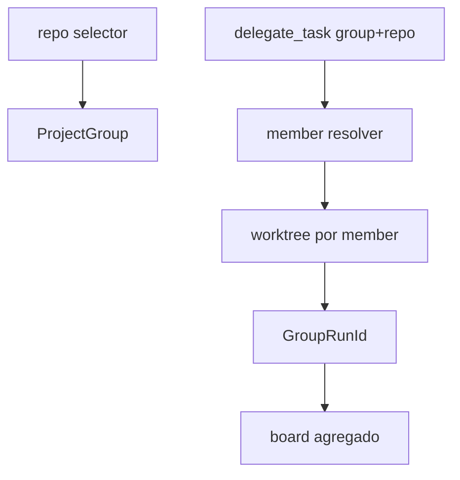

# SPEC-20261021-project-groups: workspaces multi-repo (folder workspaces)

## 0. SPEC Metadata

| Field | Value |
|---|---|
| Feature name | Project groups — agrupar repos num workspace único |
| Product / System | agent-harness (Harness) |
| Module / Bounded Context | Domain + EF + Application + Blazor (repo selector, board) + Integrations (worktree resolve) |
| Change type | Feature |
| Repository | afonsoft/agent-harness |
| Technical owner | afonsoft |
| Suggested branch | `feat/project-groups` |
| Status | `Draft` |
| Depends on | Repo selector existente, `CliWorktreeService`, `delegate_task` |
| Reference | Orca `src/main/project-groups` + `docs/model/worktrees` (folder workspaces multi-repo); README "Compared to Orca" gap ⑩ |

## 1. Executive Summary

### Problem

Cada board/run pertence a **um** repo. Workflows que cruzam front+back+
infra (um monorepo lógico espalhado em vários clones) forçam o usuário a
orquestrar worktrees soltas em projetos separados — sem visão unificada
nem dispatch coordenado.

### Solution

`ProjectGroup` entity: nome + lista ordenada de repos registrados. Um
group vira "repo" virtual no selector — board agrega cards por repo,
`delegate_task` aceita `group: "<name>"` + `repo` membro no preamble,
worktrees são criadas por repo-membro. Dispatches multi-repo (fanout que
toca 2+ membros) ganham um `GroupRun` de amarração para o board agrupar.

### Scope

In scope: CRUD de groups + selector + board agregado + dispatch por
membro + run grouping. Out of scope: `environmentRecipes` por workspace
(VM provisioning — remote-hosts), shared context cross-repo (paths são
por repo-membro), workspace folders de IDE (`.code-workspace` export é
P3 nice-to-have).

## 2. Requisitos

### Funcionais

- RF-001 `ProjectGroup` entity: `Name` (único ≤64), `Members[]`
  (`{RepoPath|GitHubRepo, Label?, Order}` ≤12), `DefaultMember`,
  `CreatedAt`. `Members` não podem conter dois paths iguais; repo precisa
  já estar registrado.
- RF-002 Selector: o combobox de repo lista groups num grupo "Groups" —
  selecionar um group mostra board agregado (colunas por status, cards
  taggeados com o member label).
- RF-003 `delegate_task`/`delegate_fanout` aceitam `group` + `repo`
  (member label ou path) — resolve para o repo real; `repo` ausente usa
  `DefaultMember`; membro fora do group → `group_member_unknown`.
- RF-004 `GroupRun` associação: tasks criadas com `group` numa mesma run
  carregam `GroupRunId` — board/run detail agrupa por group; `compare`
  gera um diff por membro tocado.
- RF-005 Worktrees: criadas por membro (`<group>-<member>-<task>` no
  nome); shared context/setup scripts resolvem **por membro** (cada repo
  tem seu `.harness/worktree.yaml`).
- RF-006 Endpoints `GET/POST/PATCH/DELETE /api/project-groups` + `POST
  /{id}/members`/`DELETE /{id}/members/{label}`; `GET
  /api/project-groups/{id}/runs`.
- RF-007 Automations `Target` ganha `group:<name>` (com `repo` member
  quando o group tem >1 membro).

### Não-funcionais

- Group é metadado leve — nenhum fs novo; a resolução é por lookup de
  path registrado.
- Membro removido com worktrees vivas → group marca o membro `archived`
  (não deleta o path, impede novo dispatch nele).
- Board agregado reusa o mesmo SignalR hub — filtro por `groupId` no
  channel (não cria grupo novo por membro).

## 3. Arquitetura

- `IProjectGroupResolver` (Application) → `repo` efetivo + `GroupRunId`.
- `GroupRun` é coluna em `AgentRun` (não entidade própria) — P1; vira
  entidade se precisar de rollup state.

## 4. Fases

- **P1** — `ProjectGroup` entity + CRUD endpoints + selector + member
  resolver em `delegate_task`.
- **P2** — board agregado + `GroupRunId` + worktree naming + compare por
  membro.
- **P3** — automations `group:` target + `.code-workspace` export +
  archive de membro.

## 5. Testes

- Unit: member resolver (default, label, path, desconhecido); membros
  duplicados rejeitados; cap 12.
- Unit: board agrupa cards por member label; `GroupRunId` propagado na
  fanout.
- Integration: create group + delegate com `group` → worktree no repo
  certo; board agregado mostra os membros.
- Integration: remover membro com worktree viva → `archived` + dispatch
  bloqueado com `group_member_archived`.

## 6. Open questions

1. Group deve ter `DefaultMember` obrigatório? Proposta: sim quando
   >1 membro — `repo` ausente vira erro ambíguo senão.
2. Shared context cross-repo (ex.: `.env` compartilhado entre membros)?
   Proposta: fora — cada membro tem seu `.harness/worktree.yaml`; um
   `group.yaml` raiz é P4.
3. `GroupRun` deve virar entidade com estado agregado (done quando todos
   os membros terminam)? Proposta: P1 coluna; P3 promove se o board
   precisar de "group done" gate.
