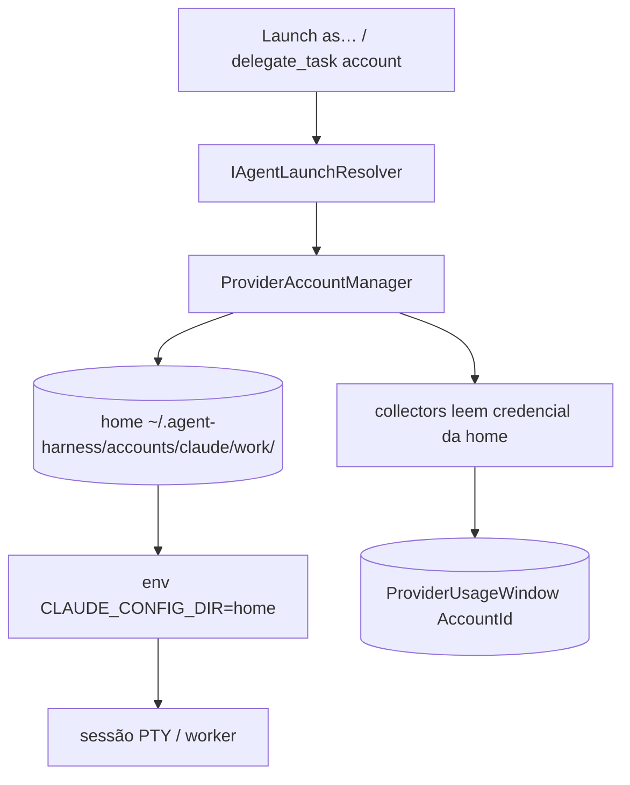

# SPEC-20261021-provider-account-hot-swap: multi-conta gerenciada por CLI (claude/codex)

## 0. SPEC Metadata

| Field | Value |
|---|---|
| Feature name | Provider account hot-swap — N contas por CLI com homes isoladas |
| Product / System | agent-harness (Harness) |
| Module / Bounded Context | Integrations (account manager, launch env) + Application + Blazor (Sessions/Agents chip) + Server |
| Change type | Feature |
| Repository | afonsoft/agent-harness |
| Technical owner | afonsoft |
| Suggested branch | `feat/provider-account-hot-swap` |
| Status | `Draft` |
| Depends on | `IAgentLaunchResolver` (launch env), `ProviderUsageService` (per-account usage), `AgentCliKind` |
| Reference | Orca `docs/agents/codex-hot-swap` + `docs/agents/supported` (contas gerenciadas, isolated homes, status-bar chip, per-account usage, config mirror c/ last-good); README "Compared to Orca" gap ③ |

## 1. Executive Summary

### Problem

Cada CLI usa **uma** credencial global (`~/.claude/.credentials.json`,
`~/.codex/auth.json`). Quando a quota da conta A esgota, o usuário troca
manualmente no shell — sessões em voo quebram, usage tracking assume um
titular só, e não há trilha de qual conta gerou qual run.

### Solution

`ProviderAccount` managed registry: N contas nomeadas por CLI, cada uma com
**home isolada** (`~/.agent-harness/accounts/<cli>/<alias>/` com dotfiles do
CLI espelhados). Launch resolve `account` → injeta `CLAUDE_CONFIG_DIR`/
`CODEX_HOME`/equivalente apontando para a home da conta. UI: chip na
status bar do session + seletor "launch as"; usage strip mostra a janela
da conta ativa. Hot-swap = próxima sessão já nasce na conta escolhida;
sessões vivas **não** migram.

### Scope

In scope: registry + isolated homes + launch-env override + per-account
usage + UI selector + `account` field em `delegate_task`. Out of scope:
login OAuth in-app (conta é registrada apontando para credencial existente
ou importada via copy de dotfiles), rotação automática por quota (P3
considera `auto-switch-on-exhausted`), contas para CLIs sem home-dir
env conhecida.

## 2. Requisitos

### Funcionais

- RF-001 `ProviderAccount` entity: `AgentCli`, `Alias` (único por cli,
  `[a-z0-9-]+` ≤32), `HomePath` (abs, sob `~/.agent-harness/accounts/`),
  `IsDefault`, `CreatedAt`, `LastUsedAtUtc`, `Disabled`.
- RF-002 `IProviderAccountManager` (Application): `Register(alias, source?)`
  — `source=credentials` copia dotfiles atuais do CLI para a home nova;
  `source=empty` cria home vazia (primeiro launch faz login nativo);
  `Remove` exige nenhuma sessão viva na conta; `SetDefault`.
- RF-003 Home isolation: `Register` faz `cp -a` dos dotfiles
  (`~/.claude` → home/`, `~/.codex` → home/`) via allowlist por CLI —
  nunca copia `history`, `sessions`, `logs`, `*.sock`.
- RF-004 Launch: `IAgentLaunchResolver` aceita `account` → seta env de
  home por CLI: claude `CLAUDE_CONFIG_DIR`, codex `CODEX_HOME`, gemini
  `GEMINI_CLI_HOME`, opencode `XDG_CONFIG_HOME` overlay; CLI sem suporte →
  `account_unsupported` error no dispatch.
- RF-005 `delegate_task`/`agent_launch` aceitam `account: "<alias>"` —
  omitido usa `IsDefault`; alias inexistente → `account_unknown` 400.
- RF-006 Per-account usage: `ProviderUsageWindow` ganha `AccountId?` —
  collectors leem credencial da home da conta (claude `/usage` com env da
  conta, anthropic api com token da conta); strip agrupa por conta.
- RF-007 Config mirror (parity Orca): `codex` config.toml espelhado por
  conta com fallback last-good — write corrompido restaura o último válido
  (file `.last-good` ao lado).
- RF-008 UI: chip "account" no session header + `Launch as…` dropdown por
  CLI na toolbar de Sessions + seção "Accounts" em Settings (lista,
  register/remove/set-default, usage por conta). Settings endpoint
  `GET/POST/DELETE /api/accounts`.
- RF-009 Feed `AccountSwitched` quando `IsDefault` muda (kind=account,
  badge provider, sem sound por default).

### Não-funcionais

- Homes sob `~/.agent-harness/accounts/` com `chmod 700`; nunca dentro do
  repo (fora do alcance de worker).
- Credenciais copiadas nunca entram em logs/telemetria — `SecretScrubber`
  cobre paths de conta; `Register` não ecoa conteúdo de dotfile.
- Máx 8 contas por CLI; home ≤1 conta por alias (unique index
  `(AgentCli, Alias)`).
- Usage sampling por conta reusa `ProviderUsageCollectJob` — uma iteração
  por conta habilitada, custo linear, cap 8→job ≤80s.

## 3. Arquitetura

- `ProviderAccount` em Domain + EF; manager em Application; env-map por
  CLI em `AgentCliAccountEnv` (Domain.Shared) — mesmo padrão
  `AgentCliResumeSupport`.
- `AgentSession`/`DelegationTask` gravam `AccountAlias` para auditoria
  (qual conta gerou o run).

## 4. Fases

- **P1** — entity + manager + isolated homes (claude + codex) + launch env
  + `account` em delegate_task.
- **P2** — per-account usage (collectors por conta + strip agrupado) +
  UI selector + Settings section + endpoints.
- **P3** — config mirror last-good (codex), `AccountSwitched` feed,
  demais CLIs com env de home documentada.

## 5. Testes

- Unit: env-map por CLI retorna env correta; CLI sem suporte → erro
  `account_unsupported`; alias inválido/duplicado rejeitado.
- Unit: `Register` copia só a allowlist (fixture com `history`/`*.sock`
  não é copiado); `Remove` com sessão viva → 409.
- Unit: collector usa token da home da conta; usage row carrega
  `AccountId`.
- Integration: `delegate_task` com `account` → PTY nasce com env da home
  (assert via `env` echo); launch sem account usa default.
- Integration: troca `IsDefault` → próximo launch muda env; conta
  desabilitada → `account_disabled`.

## 6. Open questions

1. Auto-switch quando a conta atinge `QuotaExhausted`? Proposta: P3+
   opcional `autoSwitchOnExhausted` por CLI — switch do *default* apenas,
   nunca migra sessão viva.
2. Importar credencial via paste (token colado) ou só copy de dotfiles?
   Proposta: P2 adiciona `source=paste` para CLIs token-based
   (anthropic api key), escrito com `600`, nunca logado.
3. Conta por usuário vs global? Proposta: registry global por instalação
   (single-tenant local) com `CreatedBy` audit — multi-user real fica
   para remote-hosts.
