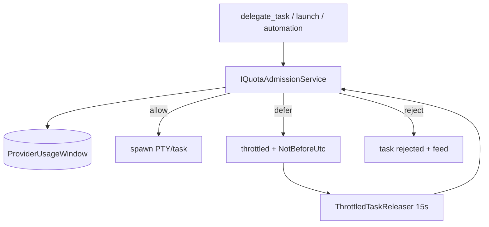

# SPEC-20261021-quota-throttling: admission control guiado por quota

## 0. SPEC Metadata

| Field | Value |
|---|---|
| Feature name | Quota-driven throttling — dispatch respeita janelas de provider |
| Product / System | agent-harness (Harness) |
| Module / Bounded Context | Application (admission service) + Integrations (delegation path) + Blazor (quota strip/tooltip) |
| Change type | Feature |
| Repository | afonsoft/agent-harness |
| Technical owner | afonsoft |
| Suggested branch | `feat/quota-throttling` |
| Status | `Draft` |
| Depends on | `SPEC-20261020-provider-quota-usage` (shipped — `ProviderUsageWindow`, `WarnLevel`, collectors) |
| Reference | Orca `src/main/rate-limits` + `rate-limits/minimax` (throttle por provider); README "Compared to Orca" gap ⑧ |

## 1. Executive Summary

### Problem

`provider-quota-usage` **observa** — mostra janelas, emite warning a 80%,
Needs You a 100% — mas o dispatch continua cego: `delegate_fanout` com 10
tasks numa claude a 98% dispara tudo, derruba a janela, e todas as runs
falham por rate-limit em vez de esperar o reset.

### Solution

`IQuotaAdmissionService` chamado antes de cada dispatch/`agent_launch`/
`automation fire`: lê a `ProviderUsageWindow` do CLI alvo e decide
`allow|defer|reject`. `defer` → task fica `throttled` com `NotBeforeUtc =
ResetsAtUtc` (jitter) e é despachada quando a janela reseta — nada é
perdido. Config por provider: `Taskboard:Quota:Throttle:<cli>` —
`hard` (defer no exhausted), `soft` (defer acima do warn), `off`
(default hard para claude/codex, soft demais). UI mostra o wait no card.

### Scope

In scope: admission check + `throttled` state + auto-release + config +
UI/feed signals. Out of scope: token-bucket próprio (não temos sinal de
rate instantâneo — decisão é por janela), routing para outro provider
(política futura `fallbackCli`), priorização entre filas.

## 2. Requisitos

### Funcionais

- RF-001 `IQuotaAdmissionService.CheckAsync(cli, userId, ct) →
  Admission {Decision(allow|defer|reject), NotBeforeUtc?, Reason}`:
  - `hard` + qualquer janela `UsedPct>=100` (fresh ≤15min) → `defer`
    até `ResetsAtUtc`+jitter(0–120s).
  - `soft` + `UsedPct>=80` → `defer` até `ResetsAtUtc`; <80 → allow.
  - dados `stale` → allow (fail-open — quota service down não trava o
    board); `reject` reservado a `Disabled` admin override.
- RF-002 Dispatch path: `AgentOrchestrationService`/`delegate_task`/
  `agent_launch` chamam `Check` antes de spawn — `defer` marca
  `DelegationTask.Status=throttled` + `ThrottledUntilUtc` +
  `ThrottleReason`; release via `ThrottledTaskReleaser` (tick 15s) que
  re-checa e despacha.
- RF-003 `DelegationTask` entity: `ThrottledUntilUtc?`, `ThrottleReason?`
  (`quota_exhausted|quota_soft|admin`); `throttled` entra no enum de
  status do board (coluna própria? não — fica em `queued` com badge
  "waiting quota").
- RF-004 `worktree_status`/run detail mostram `throttledUntil` + motivo;
  feed `QuotaThrottled` (kind=quota, badge hourglass, sem som por default)
  e `QuotaReleased` quando despacha.
- RF-005 Config: `Taskboard:Quota:Throttle:<cli> = hard|soft|off` (default
  `hard` para claude/codex, `soft` opencode/gemini/kimi, `off` os demais);
  override por usuário via `UserPreference` (`QuotaThrottleJson`) no
  mesmo shape de `PlanLimitsJson`.
- RF-006 UI: `ProviderUsageStrip` badge ganha estado `throttling` quando
  ≥1 task espera naquele provider; card da task mostra "waiting quota
  until HH:mm" + botão "Run anyway" (force-allow, audit).
- RF-007 Automations (SPEC-agent-automations) passam pelo mesmo check —
  run `skipped` com `SkipReason=quota` quando `reject`, `throttled`
  quando `defer` (re-fila até grace).
- RF-008 Métrica: `FinOps` agrega `throttled_minutes` por provider —
  visibilidade do custo de esperar vs trocar de CLI.

### Não-funcionais

- Check é read-only sobre `ProviderUsageWindow` (sem I/O no hot path —
  cache 15s por (cli,userId)).
- Fail-open em dados ausentes/stale; fail-closed só em `admin` reject.
- Jitter 0–120s para não re-disparar N tasks exatamente no reset.
- Force-allow auditado (`AgentRunEvent` `quota_override` com userId).

## 3. Arquitetura

- `QuotaAdmissionService` (Application) lê `IRepository<ProviderUsageWindow>`;
  policy table `QuotaThrottlePolicy` (Domain.Shared).
- Releaser = hosted service padrão (`ManagedJobService` pattern) com tick
  15s e re-check (janela pode ter renovado cedo).

## 4. Fases

- **P1** — admission service + `throttled` state + releaser + config
  `Taskboard:Quota:Throttle` + feed events.
- **P2** — UI (badge throttling, "waiting quota until", Run anyway) +
  user override + `worktree_status` enriquecido.
- **P3** — automations integração + `throttled_minutes` FinOps + política
  `fallbackCli` (P4 candidate).

## 5. Testes

- Unit: matrix hard/soft × fresh/stale × 79/80/100% → decisão correta;
  jitter dentro do range; fail-open em stale.
- Unit: releaser re-checa antes de despachar; `NotBeforeUtc` futuro não
  dispara.
- Integration: fanout com claude 100% → tasks `throttled` → após reset
  (fixture de `ResetsAtUtc` passado) despacham; "Run anyway" força.
- Integration: `off` nunca trava; admin reject → run `skipped` + feed.

## 6. Open questions

1. Re-check no release deve ler sample fresco (chama collector) ou aceitar
   a janela gravada? Proposta: gravada — refresh cíclico já roda;
   collector on-demand por task seria hot-path I/O.
2. `defer` deve contar como tentativa (`attempt`)? Proposta: não —
   throttling não é falha; `DispatchLog` registra `throttled` como evento
   à parte.
3. Prioridade entre tasks throttled (FIFO vs gate-order)? Proposta: FIFO
   por `CreatedAt` no P1; prioridade por run entra com `queue-priority`
   futuro.
