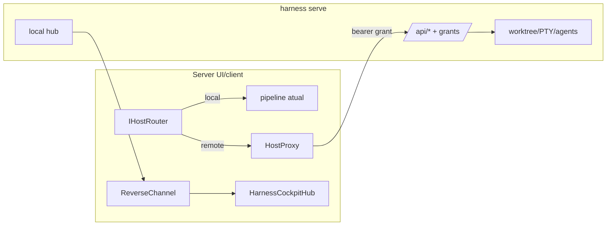

# SPEC-20261021-remote-hosts: hosts federados + pairing de servidor

## 0. SPEC Metadata

| Field | Value |
|---|---|
| Feature name | Remote/federated hosts — executar worktrees e agentes em outra máquina |
| Product / System | agent-harness (Harness) |
| Module / Bounded Context | Server (host registry, pairing, reverse-channel) + Integrations (SSH/HTTP transport) + Domain + Blazor (host badges) |
| Change type | Feature |
| Repository | afonsoft/agent-harness |
| Technical owner | afonsoft |
| Suggested branch | `feat/remote-hosts` |
| Status | `Draft` |
| Depends on | `CliWorktreeService`, PTY session infra, `delegate_task`, feed |
| Reference | Orca `docs/model/remote-servers` + `docs/recipes/remote-worktrees` (paired servers, `--on ssh:`/`runtime:`, revocable client tokens, `orca serve`, pairing URL, mobile QR); README "Compared to Orca" gap ④ |

## 1. Executive Summary

### Problem

Tudo é local: o server que hosta a UI também executa os agentes. Não há
como deixar runs pesados num servidor de build, usar credenciais que só
existem em outra máquina, ou sobreviver ao laptop fechado — o app morre,
as sessões morrem.

### Solution

Modelo host+client estilo Orca: um `harness-server` pode ser **anunciado
como host** e outros servers (ou o mesmo, como client UI) **pareiam** via
access link com token revogável. Recursos ganham `host` no routing —
`delegate_task`, `worktree create`, `agent_launch`, automations aceitam
`host: "<name>"` (default `local`). Execução remota via API autenticada
do host (mesma superfície REST local); eventos voltam por SignalR
reverse-channel. Hosts exibem badge na UI.

### Scope

In scope: host registry + pairing (link/token/grant) + `host` routing nos
entry-points de execução + reverse-channel de eventos + host badges.
Out of scope: relay/cloud público (Tailscale/LAN only — doc exige rede
privada), mobile app própria, migração de sessão viva entre hosts,
descoberta automática (mDNS) — pairing é manual por link.

## 2. Requisitos

### Funcionais

- RF-001 `RemoteHost` entity: `Name`, `BaseUrl`, `Kind(ssh|https|local)`,
  `Status(connected|disconnected|error)`, `LastSeenAtUtc`, `PairedTokenId`,
  `Capabilities {agents[], worktrees, pty}` (anunciado pelo host).
- RF-002 Pairing flow: `POST /api/hosts/pair-link` no **host** gera link
  `harness://pair?endpoint=&token=` (token single-use, TTL 15min); no
  **client**, `POST /api/hosts {name, link}` troca o token por **grant**
  persistido (`HostGrant` entity, token opaco, revogável). Host lista
  grants em `GET /api/hosts/grants`; `DELETE` revoga → client desconecta.
- RF-003 Routing: `delegate_task`, `POST /api/worktrees`, `agent_launch`,
  `POST /api/automations` aceitam `host`. `IHostRouter` resolve
  `local` → pipeline atual; remoto → proxy da chamada ao
  `BaseUrl+/api/...` do host com bearer do grant; resposta normaliza IDs
  (`remote:<host>:<id>` no board).
- RF-004 Reverse-channel: client abre SSE/SignalR outbound ao host e
  re-emite eventos (`worktree.card`, feed, `run.*`) no hub local com
  `host` tag — board mostra badge por item.
- RF-005 `harness serve --pairing-address <addr> --port 
`: modo headless
  (sem abrir UI dev-mode); imprime link de pairing; `--mobile-pairing`
  gera link escopo mobile (leitura+cockpit only).
- RF-006 Hosts page `/hosts`: tabela name/url/status/last-seen/capabilities,
  botões pair-link/add/revoke; campo `Default host for new projects`.
- RF-007 Health: ping 30s → `disconnected` após 3 falhas; dispatch para
  host down → `host_unreachable` + task fica `queued` (retry do
  orchestrator existente) em vez de falhar a run.
- RF-008 `worktree_status`/`worktree_set_status`/`terminal` transparentes
  ao host (path remoto = path no host; UI avisa "runs on <host>").

### Não-funcionais

- Token de pairing single-use, grant token = random 32B armazenado
  hasheado (SHA-256) — DB leak não revela grants ativos.
- TLS exigido para `https:` exceto loopback/Tailscale range (100.64.0.0/10)
  e `ssh:`; doc hard-rule: nunca expor porta em IP público sem túnel.
- Reverse-channel reconecta com backoff (1s→60s), dedupe por event id.
- Timeout de chamada remota 30s padrão; streaming (PTY) via canal
  separado (SignalR-to-SignalR bridge) com backpressure.

## 3. Arquitetura

- `HostProxy` = `HttpClient` nomeado + bearer handler; chamadas espelham
  a API local (mesmos DTOs).
- `ReverseChannelService` hosted service por host conectado.
- `remote:`-prefixed ids desambiguam no board; `ISessionIndexService`
  anota `Host` por sessão.

## 4. Fases

- **P1** — `RemoteHost`/`HostGrant` + pairing flow + `IHostRouter` +
  `host` em `delegate_task`/`worktrees` + health ping + host badges.
- **P2** — reverse-channel de eventos + `harness serve` headless +
  `/hosts` page + revoke UI.
- **P3** — PTY bridge remoto + capabilities negotiation + `--mobile-pairing`
  scope + automations `Host` target.

## 5. Testes

- Unit: router resolve local/remoto; host down → `queued`+retry; id
  remoto prefixado.
- Unit: pairing link single-use (reuse → 410); grant revogado → 401
  imediato.
- Integration (dois TestServers): client pair→dispatch remoto→evento
  volta pelo reverse-channel com `host` tag; revoke desconecta.
- Integration: `serve` mode sobe sem UI e imprime link válido.

## 6. Open questions

1. SSH transport ou só HTTPS-API? Proposta: HTTPS-API primeiro (reusa
   toda a superfície); `ssh:` fica `Kind` reservado para tunelamento de
   HTTP por cima de ssh, P3+.
2. Fila persistida para host offline (outbox) vs `queued`+retry? Proposta:
   retry com cap (10min) — outbox durável vira P4 se necessário.
3. Versionamento de capabilities quando hosts rodam builds diferentes?
   Proposta: `Capabilities.protocolVersion` + mínimo exigido; mismatch →
   host visível mas desabilitado ("update server").
