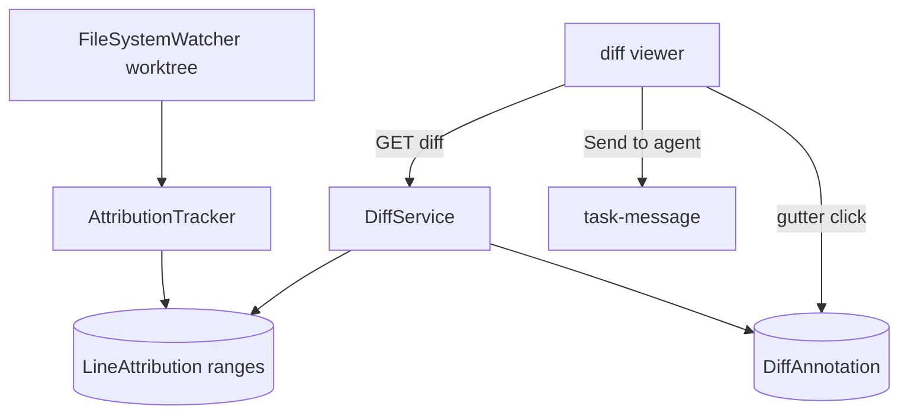

# SPEC-20261021-review-attribution: atribuição AI/humano por linha + anotações no diff

## 0. SPEC Metadata

| Field | Value |
|---|---|
| Feature name | Review surface — provenance por linha + comentários no diff |
| Product / System | agent-harness (Harness) |
| Module / Bounded Context | Integrations (file-watch attribution) + Domain + EF + Blazor (diff viewer) + Server |
| Change type | Feature |
| Repository | afonsoft/agent-harness |
| Technical owner | afonsoft |
| Suggested branch | `feat/review-attribution` |
| Status | `Draft` |
| Depends on | Diff viewer existente + `compare` de worktree, PTY/session telemetry, `WorktreeCard` |
| Reference | Orca `docs/review/attribution` (AI-vs-human por linha no gutter, flip ao editar, export) + `docs/review/commit-push` + annotate-ai-diff; README "Compared to Orca" gap ⑤ |

## 1. Executive Summary

### Problem

O diff viewer mostra o *quê* mudou, não *quem* escreveu. Revisar um PR de
agente exige ler tudo com o mesmo peso — linhas escritas por AI deveriam
receber mais escrutínio que as do humano, e hoje não há marcação nem
trilha exportável de provenance. Também não há como anotar o diff (pedir
mudança contextual) sem sair da tela.

### Solution

1. **Attribution tracking**: para cada arquivo que uma sessão de agente
   escreve (via file-watch na worktree + janela de atividade da sessão),
   registrar `LineAttribution {WorktreePath, FilePath, Ranges[],
   Origin(agent|human), SessionId?}` — aplicado no diff viewer como
   gutter marker (sutil) por linha; edição humana sobre linha AI vira
   `human`.
2. **Diff annotations**: `DiffAnnotation {FilePath, LineRef, Body,
   Author, Resolved}` — comentário inline no gutter do diff; exportável
   como checklist para o agente (`annotate` → vira contexto no próximo
   `task-message`).

### Scope

In scope: attribution por sessão ativa + gutter + anotações + export
(toolbar). Out of scope: provenance persistida em git notes/trailer
(local-only, como Orca), blame retroativo pré-implementation, ML-based
detection (heurística é por-janela-de-sessão, não classificador).

## 2. Requisitos

### Funcionais

- RF-001 `LineAttribution` entity: `RepoPath`, `WorktreePath`, `FilePath`,
  `RangesJson` (`[[start,end,origin],…]` linha-based, mergeado), `RunId?`,
  `SessionId?`, `UpdatedAt`.
- RF-002 `AttributionTracker` (Integrations): file-watch (`FileSystemWatcher`
  debounced 500ms) nas worktrees com sessão ativa → diff incremental do
  arquivo → ranges novos marcados `agent` quando a escrita ocorre dentro
  da janela `[sessionStarted, sessionDone+30s]`, senão `human`. Fallback
  sem watcher (fs ocupado): sweep a cada `run.status` change via
  `git diff --numstat` + re-leitura.
- RF-003 Aplicação: `GET /api/worktrees/{runId}/diff` retorna o diff atual
  + `attribution` por hunk/linha; UI pinta gutter `ai` (accent sutil) /
  `human` (neutro); toggle "Hide attribution".
- RF-004 Flip: linha `agent` editada depois fora de janela de sessão →
  range reclassificado `human` (merge de ranges adjacentes).
- RF-005 `DiffAnnotation` entity: `WorktreePath`, `FilePath`, `LineRef`
  (`new:N`/`old:N`), `Body` (≤2000), `Author`, `Resolved`, `CreatedAt`.
  Endpoints `POST/DELETE /api/diff-annotations`; UI: click no gutter →
  composer, thread inline, botão resolve.
- RF-006 Export: toolbar "Export annotations" → markdown checklist
  (`- [ ] file:line — body`) copiável; "Send to agent" posta o checklist
  via `task-message` do run vinculado (contexto para próxima iteração).
- RF-007 Attribution export: `GET .../diff?format=attribution` → JSON
  `{file: [{range, origin}]}` (mesmo shape do export do Orca).
- RF-008 `worker_done`/PR: resumo de provenance (`aiLines`, `humanLines`)
  anexado ao `WorktreeCard` e opcionalmente ao body do PR criado via
  `github_create_pr` (opt-in `includeAttribution`).

### Não-funcionais

- Watcher por worktree, cap 32 ativos; arquivo >2MB → marcação por hunk
  (não por linha) para não explodir `RangesJson`.
- Ranges ≤10k por arquivo; merge de ranges adjacentes contínuos.
- Attribution **não** vai para git (local-only) — export é a porta de
  saída, espelhando Orca.
- `FileSystemWatcher` em fs sem suporte (alguns NFS) → sweep on-demand
  silencioso.

## 3. Arquitetura

- `DiffService` (Application) mergeia `git diff` + `LineAttribution` +
  `DiffAnnotation`.
- Ranges como lista ordenada; rebase de linhas após nova escrita usa
  shift-deltas do diff incremental.
- `RunId`/`SessionId` linkam provenance à timeline do run.

## 4. Fases

- **P1** — `LineAttribution` + tracker (janela de sessão) + diff endpoint
  com attribution + gutter UI.
- **P2** — `DiffAnnotation` + UI inline + export checklist + Send-to-agent.
- **P3** — flip humano + merge de ranges + provenance no `worker_done`/PR
  + export formato Orca.

## 5. Testes

- Unit: merge de ranges (adjacentes, sobrepostos, flip); rebase de linhas
  após inserção acima.
- Unit: janela de sessão classifica `agent` vs `human`; watcher ausente →
  sweep funciona.
- Integration: sessão escreve arquivo → diff retorna range `agent`;
  edição manual posterior → `human`; annotation CRUD + export markdown.
- Integration: "Send to agent" → `task-message` carrega checklist no
  próximo preamble.

## 6. Open questions

1. Linhas escritas por `shell_exec`/build dentro da sessão contam como
   `agent`? Proposta: sim — heurística é janela de sessão na worktree,
   não "typed by model"; docs explicam a limitação (como Orca).
2. Guardar attribution por `RunId` ou por `WorktreePath`? Proposta: por
   worktree (sobrevive a múltiplos runs), `RunId` só como metadado da
   última escrita.
3. Annotations devem ir para o PR como review comments no GitHub?
   Proposta: P4 opt-in `POST .../push-to-github` quando worktree vinculada
   a branch remota.
