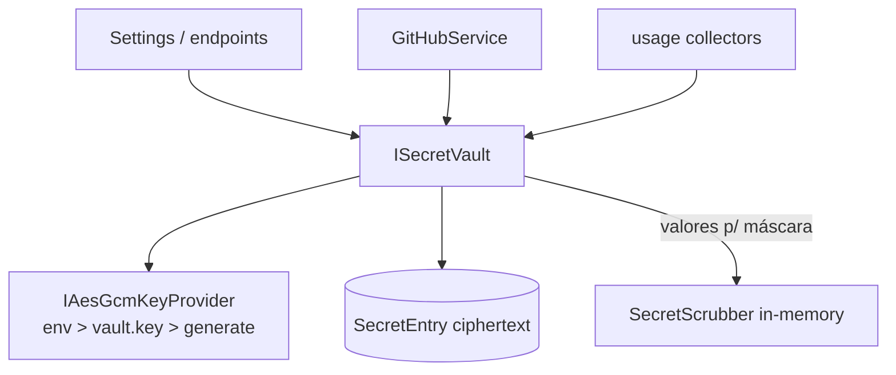

# SPEC-20261021-secrets-vault: cofre de credenciais criptografado

## 0. SPEC Metadata

| Field | Value |
|---|---|
| Feature name | Secrets vault — tokens/keys criptografados em repouso |
| Product / System | agent-harness (Harness) |
| Module / Bounded Context | Application (vault service) + EF + Server + Integrations (consumidores: GitHub, collectors, provider accounts) + Blazor (Settings) |
| Change type | Feature |
| Repository | afonsoft/agent-harness |
| Technical owner | afonsoft |
| Suggested branch | `feat/secrets-vault` |
| Status | `Draft` |
| Depends on | `UserPreference` (tokens hoje em plaintext), `SecretScrubber` (máscara em logs) |
| Reference | Orca `src/main/ai-vault` + `ai-vault-search` (cofre + busca); README "Compared to Orca" gap ⑦ |

## 1. Executive Summary

### Problem

Tokens vivem em plaintext: `UserPreference.GitHubToken`, credenciais de
provider lidas de dotfiles, futuros `ProviderAccount` homes. DB backup ou
acesso ao `harness.sqlite` expõe tudo — e qualquer feature nova que
precise de secret repete o mesmo anti-padrão.

### Solution

`SecretVault`: armazenamento criptografado em repouso (AES-256-GCM) com
chave mestra derivada de `HARNESS_VAULT_KEY` env ou arquivo
`~/.agent-harness/vault.key` (chmod 600, gerado no primeiro uso). API de
alto nível `Get/Set/Delete/List(alias)` — valores nunca saem em logs,
listagens retornam só metadados. Migração transparente dos tokens
existentes; consumidores pedem por alias (`github:token`,
`provider:claude:work:oauth`).

### Scope

In scope: vault + migração de `GitHubToken` + integração nos pontos que
hoje guardam/lêem secrets + UI Settings. Out of scope: KMS/HSM externo,
rotação de chave (P3: `vault rekey`), busca *dentro* de valores
(`ai-vault-search` pesquisa metadados — equivalente via `List` filtrado).

## 2. Requisitos

### Funcionais

- RF-001 `SecretEntry` entity: `Alias` (único, `ns:name` ≤128),
  `Ciphertext` (nonce+tag+ct), `Version`, `CreatedAt`, `UpdatedAt`,
  `LastAccessedAtUtc`, `ExpiresAtUtc?`, `MetadataJson` (≤2KB, nunca o
  valor).
- RF-002 `ISecretVault` (Application.Contracts): `Set(alias, plaintext,
  meta?)`, `Get(alias) → plaintext?`, `Delete(alias)`, `List(prefix?) →
  metadata[]`. Implementação `SecretVaultService` (Application) +
  `IAesGcmKeyProvider` (Integrations): env `HARNESS_VAULT_KEY` >
  `~/.agent-harness/vault.key` > gera.
- RF-003 Migração: hosted service one-shot move `UserPreference.GitHubToken`
  (e outros campos plaintext flagados) → `github:token`, zera a coluna,
  marca `MigratedAtUtc`; rollback documentado (re-copia antes de apagar).
- RF-004 Consumidores: `GitHubService`, collectors de usage (anthropic
  token), `ProviderAccountManager` (quando SPEC hot-swap chegar) leem via
  vault; env var continua precedência maior (`GITHUB_TOKEN` env > vault >
  pref legacy — compat).
- RF-005 Settings UI: seção "Secrets" — list (alias+meta, valor mascarado),
  add/edit (write-only: após save o campo esvazia), delete, "migrated"
  badge nas entradas auto-migradas.
- RF-006 Endpoints `GET/PUT/DELETE /api/secrets` — GET nunca retorna
  plaintext (só metadados); `POST /api/secrets/{alias}/reveal` com
  confirmação auditada (log `secret_revealed` sem valor).
- RF-007 Tool surface: agentes **não** recebem `vault_get` — secrets são
  injetados como env no launch pelo host (mesma política do
  `SecretScrubber`: valor nunca transita por mailbox/preamble).

### Não-funcionais

- AES-256-GCM, nonce 96-bit único por write (gerado por write, nunca
  reusado por chave); chave mestra 32B, `600`, fora do repo e do DB.
- `SecretScrubber` ganha feed do vault: valores ativos entram na lista de
  máscara em memória (não persistida) — logs nunca mostram o plaintext
  mesmo se o valor vazar por outro caminho.
- DB dump expõe ciphertext+nonce apenas; sem a `vault.key` nada é
  decifrável. Doc: backup de `harness.sqlite` sem `vault.key` = secrets
  inacessíveis (feature, não bug).
- `reveal` rate-limit: 10/min por usuário; falhas de decifração →
  `vault_corrupt` + entry marcada `broken` (não deleta).

## 3. Arquitetura

- Cripto em `Taskboard.Application` (BCL `AesGcm`, sem nova dep);
  key provider em Integrations (fs/env).
- Migração one-shot: `SecretVaultMigrationService` hosted service com
  sentinel em `UserPreference` (`VaultMigrated`).

## 4. Fases

- **P1** — `SecretEntry` + `AesGcmKeyProvider` + `SecretVaultService` +
  endpoints + migração `GitHubToken`.
- **P2** — Settings UI + reveal auditado + `SecretScrubber` mask-feed +
  collectors via vault.
- **P3** — `vault rekey` + `ExpiresAtUtc` enforcement + docs de backup.

## 5. Testes

- Unit: round-trip encrypt/decrypt; nonce único por write; ciphertext
  adulterado → `vault_corrupt`; key ausente → gera `vault.key` 600.
- Unit: precedência env>vault>legacy; reveal incrementa audit.
- Integration: migração — pref com token vira entry `github:token` +
  coluna zerada; `GitHubService` opera após migração.
- Integration: GET lista sem plaintext; reveal exige auth; scrubber
  mascara valor do vault em log simulado.

## 6. Open questions

1. Passphrase do usuário vs key-file auto-gerado? Proposta: key-file
   (local-first, zero-friction) — passphrase vira opção
   `HARNESS_VAULT_KEY_PROMPT` no P3.
2. `vault.key` perdida → entries irrecuperáveis: aceitar e documentar, ou
   guardar recovery? Proposta: aceitar + doc; export sealed-backup
   (`vault export --passphrase`) no P3.
3. Env `HARNESS_VAULT_KEY` em claro na env do processo é leak por
   `/proc/*/environ`? Proposta: aceitar para server-managed; doc
   recomenda key-file para local.
