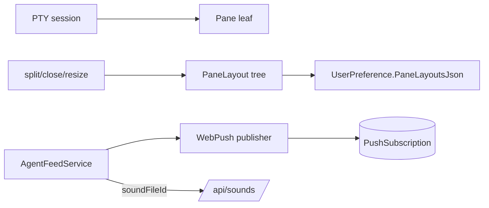

# SPEC-20261021-terminal-ux-notifications: splits de terminal + notificações de SO

## 0. SPEC Metadata

| Field | Value |
|---|---|
| Feature name | Terminal splits + OS-level notifications + custom sounds |
| Product / System | agent-harness (Harness) |
| Module / Bounded Context | Blazor (layout engine, terminal component) + Server (push) + Application (feed prefs) |
| Change type | Feature |
| Repository | afonsoft/agent-harness |
| Technical owner | afonsoft |
| Suggested branch | `feat/terminal-ux-notifications` |
| Status | `Draft` |
| Depends on | Terminal tabs existentes (E23 mobile UX), `AgentFeedService` (kinds/sound categories), `ChatPushSubscriptions` |
| Reference | Orca `docs/model/tabs-panes-splits` (nested splits, restore) + `docs/notifications` (OS notif + Dock badge + custom sound files/volume); README "Compared to Orca" gaps ⑨ |

## 1. Executive Summary

### Problem

Duas lacunas de UX: (a) terminal é só tabs — comparar dois workers ou
ver log+cockpit lado a lado exige janela extra do browser; (b) feed é
in-app — agente que termina com a aba minimizada não "chama" o usuário
(no Orca: notificação de SO + badge no Dock + som por categoria).

### Solution

1. **Splits**: modelo de árvore `PaneLayout` por worktree —
   `split-horizontal|vertical` cria panes irmãos no mesmo tab-context;
   cada pane hospeda uma sessão (PTY, board, chat, log). Persistido por
   usuário+worktree; drag-resize; `close pane`.
2. **OS notifications**: Web Push (reusa `ChatPushSubscription` +
   `PushSubscription` infra existente) para `NeedsYou`, `QuotaExhausted`,
   `RunFailed`, `AutomationRun`; categoria/toggle/volume em Settings;
   título clicável abre deep-link.
3. **Custom sounds**: upload de arquivo (mp3/wav/ogg ≤2MB) por categoria
   de feed + volume; fallback para o som embutido da categoria.

### Scope

In scope: splits 1-nível-aninhável + Web Push + custom sounds + settings.
Out of scope: Dock badge real (browser-only — Badging API quando suportado
cobre o caso), layout restore cross-browser (persiste por usuário no
server, não por device), mobile splits (touch = tabs só).

## 2. Requisitos

### Funcionais

- RF-001 `PaneLayout` model (Blazor state, persistido em
  `UserPreference.PaneLayoutsJson`): árvore `{split: h|v, sizes:[%],
  children:[leaf|node]}`, leaf = `{kind: pty|board|chat|log, refId}`;
  por `worktreePath`+`userId`, cap 8 leaves.
- RF-002 UI: botão split no pane header + `Alt+\`/`Alt+-` shortcuts;
  drag-resize com snap; close pane devolve o espaço ao irmão; nested
  splits até depth 3.
- RF-003 Web Push: `AgentFeedService` ganha publisher de push para kinds
  `NeedsYou|QuotaExhausted|RunFailed|AutomationRun` (VAPID via
  `Taskboard:Push:*` já existente); payload `{title, body, url}` → click
  abre deep-link.
- RF-004 Per-category toggles: `AgentFeedPreference` estende com
  `PushEnabled` por kind + `SoundFileId?` + `Volume(0–100)`; UI Settings
  → seção "Notifications" (togglles por categoria, upload de som,
  slider).
- RF-005 `UserSoundFile` store: upload via `POST /api/sounds` (≤2MB,
  mime whitelist), servido `/api/sounds/{id}` com cache; feed player
  usa custom quando setado.
- RF-006 Badging API (`navigator.setAppBadge`) com unread count do feed —
  no-op onde não suportado.
- RF-007 "Mark unread" em notificação de feed (clique-direito/item action)
  — volta a contar no badge (parity Orca inbox).

### Não-funcionais

- Split renderiza ≤4 PTYs simultâneos por worktree (cap de watchers);
  pane extra mostra "attach" picker em vez de auto-spawn.
- Push só disparado para usuário com subscription ativa + kind habilitado;
  payload sem conteúdo sensível (título genérico + url).
- Som custom: decode no client (WebAudio), sem pipeline server além do
  store; formato inválido rejeita no upload.
- Layout restore: última árvore válida ganha; json corrompido → default
  single-pane sem erro.

## 3. Arquitetura

- `PaneLayoutComponent` (Blazor) recursivo; host de leaf por `kind`.
- Push publisher reusa `ChatPushSubscription` infra + `WebPush` client já
  presente para chat.
- Preferences service estendido (mesmo padrão `AgentFeedPreferenceService`).

## 4. Fases

- **P1** — PaneLayout + split/close/resize + persist + shortcuts.
- **P2** — Web Push para os 4 kinds + toggles por categoria + deep-link.
- **P3** — custom sounds upload/player + Badging + mark-unread.

## 5. Testes

- Unit: árvore split/close mantém invariantes (somas de sizes, depth ≤3,
  leaf cap); restore com json corrompido → default.
- Unit: push só dispara quando kind habilitado + subscription existe;
  payload sanitizado.
- Integration: `POST /api/sounds` mime/size guard; `GET` serve bytes;
  prefs round-trip com `SoundFileId`+`Volume`.
- Integration: feed NeedsYou → push enviado (fake `IPushSender`) uma vez
  por subscription.

## 6. Open questions

1. Splits devem ser por worktree ou globais (dashboard-style)? Proposta:
   por worktree (o modelo mental é "dentro deste card"); global vira
   "Cockpit layout" separado no P4.
2. Push quando a aba está focada — suprimir? Proposta: sim (visibility
   check client-side reporta `focused=true` → só feed in-app).
3. Som por *agente* além de por categoria? Proposta: categoria primeiro;
   por-agente é `SoundFileId` extra na preferência do agente no P4.
