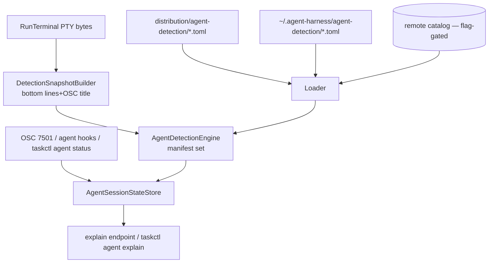

# SPEC-20261104-agent-attention-manifests: TOML detection catalog, explain diagnostics, hot reload

## 0. SPEC Metadata

| Field | Value |
|---|---|
| Feature name | Agent attention manifests — data-driven screen/status detection catalog |
| Product / System | agent-harness (Harness) |
| Module / Bounded Context | Integrations (Agents/Attention) + Application + Server + tooling |
| Change type | Feature |
| Repository | afonsoft/agent-harness |
| Suggested branch | `feat/agent-attention-manifests` |
| Technical owner | afonsoft |
| Status | `Draft` |
| Date | 2026-11-04 |
| Depends on | SPEC-20261020-agent-attention-model (state store + signal pipeline); SPEC-20261104-run-terminal-runtime (bottom-buffer source) |
| Reference | COMPARISON-20261104-herdr-agent-runtime §1.3 — herdr `distribution/agent-detection/*.toml`, `agent explain`, `reload-agent-manifests` |

## 1. Executive Summary

### Problem

The attention-model spec detects `waiting_you`/`blocked` via a hardcoded
`AgentCliAttentionPatterns` table — one row per CLI in code. That doesn't scale to
20+ agent CLIs, every rule change needs a release, a misfiring rule can't be
overridden locally, and there's no way to answer *"why does this session show
blocked?"* without reading engine internals. Herdr ships detection as **data**: a
versioned TOML manifest per agent (priority-ordered rules over terminal regions with
AND/OR/NOT gates), a remotely-updatable catalog, local override files, hot reload,
and `agent explain` diagnostics.

### Solution

Replace the hardcoded pattern table with a **manifest engine**:

- `AgentDetectionManifest` parsed from TOML — bundled defaults under
  `distribution/agent-detection/`, local overrides under
  `~/.agent-harness/agent-detection/`, optional remote catalog refresh.
- Rules evaluate a **detection snapshot** (bottom non-empty buffer lines, OSC title,
  region above the prompt box) — never the user-scrollable viewport.
- `AgentState` from manifests maps onto the attention store's states
  (`idle|working|done|blocked|error`); **reported status (OSC 7501 / managed hooks /
  `taskctl agent status`) always outranks manifest heuristics**.
- Diagnostics: `taskctl agent explain <session>` + `GET
  /api/local/agents/{id}/attention/explain` return manifest source, rules evaluated,
  matched rule, evidence flags.
- `POST /api/local/agents/detection/reload` (or `taskctl agent reload-manifests`)
  hot-reloads without restart; override files win over bundled.

### Out of scope

- Remote catalog signing/transport details (phase 2 — ship bundled + local first,
  remote refresh behind a config flag with digest pinning).
- Manifest authoring UI; detection for non-terminal sessions (chat) stays on
  harness signals.

## 2. Requirements

### Functional

- **RF-001 Manifest schema (TOML):**
  `id`, `version`, `min_engine_version`, `updated_at`, `aliases[]`, `[[rules]]`:
  `id`, `state(idle|working|done|blocked|error)`, `priority` (higher wins),
  `region(bottom_non_empty_lines(N)|osc_title|last_non_empty_above_prompt_box|full_buffer)`,
  gates — `contains[]` (all), `any[]` (or), `all[]`, `not[]`, `regex[]`,
  `line_regex[]` — and flags `visible_blocker`, `visible_working`, `visible_idle`.
  `skip_state` optional: rule only applies when current state differs.
- **RF-002 Engine.** `IAgentDetectionEngine.Evaluate(snapshot, cliId)`:
  ordered by priority, first fully-matching rule wins; `not` gates veto;
  produces `{state, ruleId, manifestSource(bundled|override|remote), flags}`.
  No match → `unknown` (never silently `idle`). Evaluation is pure — snapshot
  in, verdict out; no parser/viewport access.
- **RF-003 Snapshot builder.** From the run terminal's live buffer: bottom N
  non-empty lines, OSC title, region above prompt box — plus ANSI-stripped text.
  Detection runs on output chunks (debounced ≤4/s) and on status-report events.
- **RF-004 Source precedence.** reported status (OSC 7501/hook/`taskctl agent
  status`) > local override manifest > remote catalog > bundled. Reported status
  holds until a fresh report or terminal exit; heuristics never override a live
  report (except `exited` from process death — always wins).
- **RF-005 Local overrides.** `~/.agent-harness/agent-detection/<cli>.toml` shadows
  bundled for that CLI; loader validates schema (bad file → that CLI falls back to
  bundled + warning surfaced in `explain`, not a startup failure).
- **RF-006 Hot reload.** `POST /api/local/agents/detection/reload` rescans override
  + catalog dirs and swaps the engine's manifest set atomically; feed event
  `AgentDetectionReloaded {cliCount, overrideCount}`.
- **RF-007 Explain.** `GET /api/local/agents/{session}/attention/explain` →
  `{state, manifestSource, matchedRule{id,priority,region}, evaluatedRules
  [{id,matched,failedGate}], evidenceFlags[], snapshotHash}`; `taskctl agent
  explain <session>` renders it. Used to debug false positive/negative states.
- **RF-008 Bundled catalog.** Seed manifests for the CLIs we already support:
  claude, devin, codex, opencode, gemini, agy (+ generic `shell` fallback for
  `waiting_you` patterns). `distribution/agent-detection/index.toml`
  (`schema_version`, `[[agents]] id/path`) mirrors herdr's layout for a future
  remote channel.
- **RF-009 Version gates.** Manifest with `min_engine_version` > engine → skipped
  with `incompatible` marker in explain; catalog `schema_version` > supported →
  whole catalog ignored (never partially parsed).

### Non-functional

- Evaluation ≤1ms per snapshot per manifest typical; bottom-buffer extraction is
  the only buffer access (no full-viewport scans per chunk).
- Engine state is lock-free swappable (single immutable manifest set reference).

## 3. Architecture

- `src/Taskboard.Integrations/Agents/Attention/` — `AgentDetectionManifest` (TOML via
  `Tomlyn`), `AgentDetectionEngine`, `DetectionSnapshotBuilder`,
  `AgentDetectionManifestLoader` (precedence + validation),
  `AgentDetectionReloadService`.
- `distribution/agent-detection/` at repo root — bundled catalog + `index.toml`;
  packaged into the server output + install.sh.
- Attention-model's `AgentCliAttentionPatterns` table deleted; `waiting_you` patterns
  become the `shell` fallback manifest.

## 4. Security

- Manifests are data, not code — no script execution; regexes run with a 100ms
  `RegexOptions.NonBacktracking`-safe timeout (aligns with existing S6444 fix).
- Remote catalog refresh validates `index.toml` digest + per-manifest SHA-256 before
  accepting (phase-2 flag; default off until signing lands).
- Override dir is user-home local; the server never writes manifests — only reads.

## 5. Tests

- `ManifestParseTests` — schema fields, gate combinators, priority ordering,
  `min_engine_version` skip, bad TOML → fallback + warning.
- `EngineTests` — synthetic snapshots: blocked rule beats idle on priority;
  `not` gate vetoes; `line_regex` anchors; `unknown` on no match; OSC-title region.
- `PrecedenceTests` — reported status outranks manifest; override shadows bundled;
  process exit forces `exited` regardless.
- `ReloadTests` — add/edit/remove override file + reload → engine verdict changes
  without restart; atomic swap (no mid-eval torn set).
- `ExplainTests` — verdict carries manifestSource + matchedRule + failedGate list.
- Integration — fake PTY session emitting a Claude-style permission footer →
  `blocked`; OSC 7501 `working` report → manifest `idle` rule does not override.

## 6. Acceptance Criteria

- [ ] Adding `~/.agent-harness/agent-detection/mycli.toml` + reload detects a new
      CLI's states with zero code changes.
- [ ] `taskctl agent explain <session>` shows which rule fired and which gates
      failed for the losing rules.
- [ ] A bundled-manifest regex bug can be fixed by dropping an override file —
      no release required.
- [ ] Explicit `taskctl agent status done` is never overridden by a stale
      `working` heuristic.
