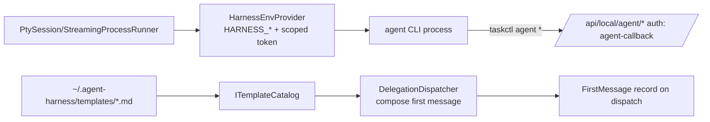

# SPEC-20261104-agent-context-templates: HARNESS_* env injection, callback surface, named task templates

## 0. SPEC Metadata

| Field | Value |
|---|---|
| Feature name | Agent context injection + task templates + agent callback surface |
| Product / System | agent-harness (Harness) |
| Module / Bounded Context | Integrations (Agents/Execution) + Application + CLI + Chat tools |
| Change type | Feature |
| Repository | afonsoft/agent-harness |
| Suggested branch | `feat/agent-context-templates` |
| Technical owner | afonsoft |
| Status | `Draft` |
| Date | 2026-11-04 |
| Depends on | SPEC-20261104-run-terminal-runtime (run terminals carry the env block); contract-v2 `PreambleJson` |
| Related SPECs | SPEC-20261022-sdd-worker-brief, SPEC-20261101-taskctl-skill-cli-sync, SPEC-20261104-cli-agent-manual |
| Reference | COMPARISON-20261104-herdr-agent-runtime §1.1, §2 — `$HC_TERMINAL_ID`, `hc templates`, `first_message.sent` |

## 1. Executive Summary

### Problem

A delegated agent today learns its coordination context **from prompt text** — the
preamble embeds task id, mailbox address, contract text. Text is fragile: the agent
may truncate it, ignore it, or fail to echo it back; and nothing in its *environment*
says who it is, so a CLI that wants to `agent_send` mid-run has no machine-readable
address or credential. Herdr solves this at the OS level: every managed terminal gets
`$HC_TERMINAL_ID` — the agent's own address — and the skill manual teaches "report
with `hc send $HC_TERMINAL_ID`".

Second gap: **no reusable agent templates**. `hc templates` are Markdown files with
`{name, description, command(incl. model)}` frontmatter whose body supplies standing
instructions ("reviewer", "simplifier"); template + task compose the agent's first
message, and `first_message: {sent, reason}` is persisted durably. Our worker-brief
is generated per task — no named, inspectable, user-editable roles.

### Solution

1. **Context env block**: every managed agent spawn (run terminal or streaming path)
   receives `HARNESS_*` variables: own address, scope, task/dispatch ids, mailbox
   address, API base URL, and a **scoped callback token**. Keep stripping `TASKBOARD_*`
   legacy names; the new block is injected, never inherited.
2. **Callback surface**: `taskctl agent <verb>` — a thin authenticated client for
   in-agent use (`send`, `report`, `status`, `done`, `ask`), documented by the
   `--skill` manual (companion spec). Token scopes the caller to its own scope.
3. **Templates**: `~/.agent-harness/templates/<name>.md`, frontmatter
   `{name, description, cli?, command?, model?, effort?, interactive?}` + body;
   `delegate_task --template <name>` composes `body + task` as first message;
   `FirstMessage {sent, reason}` persisted on the dispatch (aligned with
   run-terminal RF-002) — `GET /api/local/delegation/tasks/{id}` exposes it.

### Out of scope

- Template marketplace/sharing; per-user vs global template dirs beyond the one path.
- Templating inside prompts beyond `{{task}}`/`{{scope}}` substitution.
- GUI template editor (list/apply via CLI + API only).

## 2. Requirements

### Functional

- **RF-001 Env block.** On spawn, inject:
  `HARNESS_SESSION_ID` (run terminal/session key), `HARNESS_TASK_ID`,
  `HARNESS_DISPATCH_ID` (when present), `HARNESS_SCOPE` (mailbox scope),
  `HARNESS_AGENT_NAME` (assigned worker name), `HARNESS_API_URL` (loopback base),
  `HARNESS_AGENT_TOKEN` (scoped JWT or opaque token, TTL = run lifetime, audience
  `agent-callback`, claims: scope + taskId + dispatchId — read-only status + mailbox
  write to own scope + own `worker_done`/`escalation`/`ask` emissions).
  `WithoutTaskboardEnv` keeps stripping `TASKBOARD_*`; `HARNESS_*` is set fresh per
  spawn — a token from run A never reaches run B's process.
- **RF-002 Callback surface.** `taskctl agent send <text>` (mailbox to scope
  coordinator), `taskctl agent status <working|blocked|done|error> [note]` (explicit
  status report — feeds the reported-status channel of the attention layer),
  `taskctl agent done 
` (worker_done), `taskctl agent ask <question>`
  (contract-v2 ask), `taskctl agent report` (returns own observed context JSON).
  Reads `HARNESS_API_URL`+`HARNESS_AGENT_TOKEN`; outside a managed run → clear error
  (`kind: no_context`, hint to run under the harness).
- **RF-003 Templates.** `ITemplateCatalog` scans `~/.agent-harness/templates/*.md`;
  frontmatter validated (`name` == filename stem; `command` optional override argv;
  `model`/`effort` flow into launch prefs). `taskctl templates` lists;
  `delegate_task {prompt, template}` and `delegate_plan` items accept `template`.
  Missing/invalid template → tool refusal with the validation error.
- **RF-004 First-message record.** Dispatch carries `FirstMessage {sent, reason?,
  sentAtUtc?}`: `sent=false, reason=not_ready|timeout|refused` is inspectable via
  `delegate_status --verbose` and the tasks GET — surviving restarts. Recovery is
  explicit (`run_send` after `run_read`), never blind resend.
- **RF-005 Env for terminal page.** Interactive Terminal-page agent launches get
  `HARNESS_SESSION_ID` + `HARNESS_API_URL` + token scoped `status-report` only
  (no mailbox write) — status button/hook parity without delegation privileges.

### Non-functional

- Token mint ≤5ms, verified without DB hit (signed claims + scope lookup).
- Env values never logged: `ISecretRedactor` rules added for `HARNESS_AGENT_TOKEN`.
- Template parse failures are isolated per-file (one bad template doesn't break
  catalog listing — reported with error marker).

## 3. Architecture

- `src/Taskboard.Integrations/Execution/HarnessEnvironmentProvider.cs` — builds the
  env block + mints tokens via `IAgentCallbackTokenService` (new, Server-side).
- `src/Taskboard.Application/Agents/AgentTemplateCatalog.cs` + DTOs in Contracts.
- `src/Taskboard.Server/Program.cs` — `/api/local/agent/{send,status,done,ask,report}`
  minimal endpoints, `agent-callback` auth policy.
- `src/Taskboard.Cli/Commands/AgentCommands.cs` — `taskctl agent *` + `templates`.

## 4. Security

- Token is scoped to exactly one scope+task; `escalation`/`decision` emissions allowed
  only for own dispatch (validated against `HARNESS_DISPATCH_ID` claim).
- `HARNESS_AGENT_TOKEN` redacted by `ISecretRedactor` in all logs/read-backs.
- Templates are local files — no remote fetch; `command` override honored only for
  templates marked `trusted: true`? No — simpler: `command` override honored only
  when `cli` matches a known interactive CLI, never a free shell string.

## 5. Tests

- `HarnessEnvironmentProviderTests` — block contains required keys, token claims
  match task/dispatch, no `TASKBOARD_*` leaks, tokens differ per spawn.
- `AgentCallbackEndpointTests` — 401 without token; scope violation → 403;
  `status` writes reported-status channel; `done` emits worker_done for own task.
- `AgentTemplateCatalogTests` — frontmatter parse, name==stem validation, bad file
  isolated, `delegate_task --template` composes body+task.
- `FirstMessageTests` — timeout → `{sent:false, reason:not_ready}` persisted;
  explicit resend flips `sent:true` once (idempotent).

## 6. Acceptance Criteria

- [ ] A spawned agent sees `HARNESS_TASK_ID`/`HARNESS_AGENT_TOKEN` in its env and
      `taskctl agent send "…"` lands in the scope mailbox as that worker.
- [ ] `taskctl agent status blocked` drives the attention store (Needs You).
- [ ] `delegate_task --template reviewer` composes template body + prompt as the
      first message; a failed delivery leaves inspectable `FirstMessage{sent:false}`.
- [ ] Running `taskctl agent send` outside a managed run fails with `no_context`.
