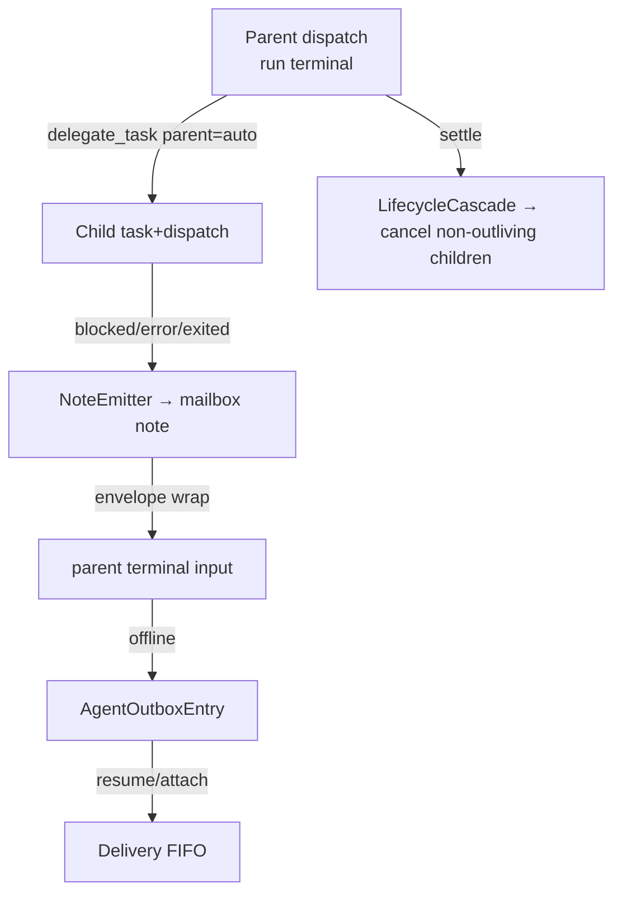

# SPEC-20261104-agent-lineage-notes: parent/child lineage, lifecycle coupling, notes + outbox, provenance envelope

## 0. SPEC Metadata

| Field | Value |
|---|---|
| Feature name | Agent lineage + notes/outbox + provenance envelope |
| Product / System | agent-harness (Harness) |
| Module / Bounded Context | Domain (Delegation) + Application + Integrations + Chat tools |
| Change type | Feature |
| Repository | afonsoft/agent-harness |
| Suggested branch | `feat/agent-lineage-notes` |
| Technical owner | afonsoft |
| Status | `InImplementation — Phase A implemented` |
| Date | 2026-11-04 |
| Depends on | SPEC-20261104-run-terminal-runtime (live sessions to notify); contract-v2 Run/Dispatch/Delivery |
| Related SPECs | SPEC-20261022-mailbox-wake (implemented), SPEC-20261005-delegation-dag-mailbox |
| Reference | COMPARISON-20261104-herdr-agent-runtime §2 — `HC_TERMINAL_ID` lineage, notes, `<hc from>` tags, Outbox |

## 1. Executive Summary

### Problem

Our delegation graph is flat: a task's dispatches have no parent/child relationship
with the dispatch that spawned them, so —

- **No lifecycle coupling**: an orchestrator run dies; the child workers it spawned
  keep running orphaned, billing tokens against nobody.
- **No push channel for child events**: a child that blocks/errors/exits only
  surfaces at settle (`worker_done`) or the next status poll. Herdr pushes **notes**
  into the parent's input stream the moment a child needs attention.
- **Weak provenance**: mailbox rows have `FromAgent`, but text transported through a
  prompt carries no in-band envelope — an agent reading its input can't tell a
  child report from a user instruction.
- **No offline queue**: messages for a hibernated/detached consumer rely on the
  mailbox table alone; herdr's per-peer `Outbox` flushes on reconnect and preserves
  ordering.

### Solution

1. **Lineage**: `Dispatch.ParentDispatchId` (nullable) set whenever a running agent
   creates a task via tools (or explicitly `--parent`). `OutliveParent` flag;
   default = child finishes when parent finishes (cascade `cancelled`
   reason `parent_finished`, process-tree kill via the run terminal).
2. **Notes**: child state transitions to `blocked`, `error`, `exited` generate a
   `note` mailbox message to the parent's session address (`ToAgent =
   parent dispatch/session key`), kind `note`, payload `{childId, event, state,
   snippet}`. Notes arrive in the parent's inbox without polling; `--no-notify`
   opt-out per task (`NotifyParent=false` on the DelegationTask).
3. **Provenance envelope**: agent-bound messages transported into a run terminal
   are wrapped `<harness from="<name> <taskId>" reach="<reply hint>">…</harness>`;
   parsers treat envelope content as inter-agent traffic, never user instructions
   (worker-brief teaches this).
4. **Outbox**: `AgentOutboxEntry` queue per unreachable recipient session
   (hibernated or detached) — notes/messages enqueue, flush in order on resume/
   reattach through the existing Delivery+ack machinery (contract-v2 RF-003).

### Out of scope

- Cross-host outbox (remote-ops spec); `@children` broadcast address semantics
  beyond direct lineage.
- `wait --children` compound waits — covered by run-terminal `run_wait` +
  this spec's lineage index (`run_wait --children` listed as phase 2).

## 2. Requirements

### Functional

- **RF-001 Lineage.** `Dispatch.ParentDispatchId`, `DelegationTask.OutliveParent`
  (default `false`), `DelegationTask.NotifyParent` (default `true`). Tools:
  `delegate_task` gains `parent` (dispatch/task id, default = caller's dispatch
  when invoked from inside a run terminal context) and `outlive_parent`.
  Cycle check: parent chain must terminate at a root (depth ≤4, configurable).
- **RF-002 Cascade.** Parent dispatch settles (`done|failed|cancelled|abandoned`)
  → non-outliving children get `cancelled` + `reason: parent_finished` and their
  run terminals killed (whole tree). `OutliveParent=true` children keep running
  and reparent their notes to the run coordinator address.
- **RF-003 Notes.** On child transitions `blocked|error|exited` (from the
  attention store / run terminal), emit `note` to parent session address:
  `payload {childTaskId, childDispatchId, event, state, screenSnippet≤2k}`.
  Dedup: one note per (child,event) until state changes again. `NotifyParent=false`
  suppresses. `exited` note includes exit code.
- **RF-004 Envelope.** Mailbox→terminal delivery wraps payload:
  `<harness from="<agentName> <taskId>" scope="<scope>" reach="taskctl agent send …">`
  `…</harness>`. Worker-brief + `--skill` manual document: envelope = inter-agent
  report; `reach` = how to reply. Plain human chat text is never wrapped.
- **RF-005 Outbox.** `AgentOutboxEntry {Id, SessionKey, MessageId, CreatedAtUtc}`
  for recipients that are hibernated/detached sessions; on `SessionResumed`/
  attach, entries flush oldest-first as Deliveries through the existing
  `CheckDeliveriesAsync` path (at-least-once preserved; mailbox-wake keeps
  working — wake first, then flush).
- **RF-006 Lineage surface.** `delegate_status --tree` renders the dispatch forest
  (parent→children, states); `GET /api/local/delegation/tasks/{id}` returns
  `children[]`. Feed event `AgentNoteReceived` (child event kind in payload).

### Non-functional

- Notes delivery is asynchronous, ≤2s from transition to parent-visible under
  normal load; never blocks the child's own progress.
- Outbox bounded per session (default 500 entries; overflow drops oldest `text`
  kind first, never `note`/`worker_done`; overflow emits feed warning).
- Cascade is best-effort idempotent — child already finished is skipped; cascade
  runs inside the settle transaction's post-commit step.

## 2.1 Phase A — implemented (feat/agent-lineage-notes)

- `Dispatch.ParentDispatchId`, `DelegationTask.{ParentDispatchId, OutliveParent,
  NotifyParent}` + migration `AddAgentLineageNotes`; DTOs expose the fields.
- `delegate_task` params `parent` / `outlive_parent` / `no_notify`; service
  resolves dispatch-or-task ids, enforces depth ≤ 4 and cycle rejection.
- Cascade in `FinishRunAsync`/`CancelTaskAsync`: open children → dispatch
  `Abandoned` + task `Cancelled` reason `parent_finished` (OutliveParent skipped).
- `note` mailbox kind: settle/cancel posts JSON payload to
  `disp:{parentDispatchId}` — suppressed by `NotifyParent=false`.
- `AgentOutboxEntry` entity + EF config created (table + index).

## 2.2 Phase B — pending (blocked on run-terminal merge)

- Note push into the parent's live terminal input + `<harness …>` envelope.
- Outbox flush on resume/attach through Delivery machinery; hibernation hook.
- `delegate_status --tree`, `GET …/tasks/{id}` children[], feed
  `AgentNoteReceived`, run-terminal kill of cascaded children.
- RF-001 note: `parent` defaults to explicit param — the "auto-parent from
  run-terminal context" needs dispatch context on the tool path (phase B).

## 3. Architecture

- Domain: `Dispatch.ParentDispatchId`, `DelegationTask.{OutliveParent,NotifyParent}`,
  `AgentOutboxEntry` + EF migration + `IAgentOutboxRepository`.
- Integrations: `AgentNoteEmitter` (subscribes attention-store transitions for
  sessions bound to dispatches), `LifecycleCascadeService` (settle hook),
  `MailboxEnvelopeFormatter`.
- Tools: `delegate_task --parent/--outlive-parent/--no-notify`,
  `delegate_status --tree`; brief/manual text updates.

## 4. Security

- Notes only flow to the verified parent session of the same scope (or run
  coordinator when reparented) — lineage is validated at emit time, never from
  agent-supplied parent claims alone.
- Envelope content is opaque text; the formatter strips `HARNESS_AGENT_TOKEN`-
  class secrets via `ISecretRedactor` before wrapping.
- Cascade never kills `OutliveParent` or human-attached (`ControlOwner=human`)
  children — those reparent + note instead.

## 5. Tests

- `LineageTests` — parent set from tool context; explicit `--parent`; cycle/depth
  rejection; legacy tasks (null parent) unaffected.
- `CascadeTests` — parent done cancels running children; outliving children keep
  running and reparent notes; already-finished child skipped; human-attached child
  not killed.
- `NotesTests` — blocked/error/exited emit exactly one note per transition; dedup
  on unchanged state; `NotifyParent=false` silent; snippet redaction.
- `OutboxTests` — hibernated recipient queues; resume flushes FIFO via deliveries;
  overflow policy drops `text` first + feed warning.
- `EnvelopeTests` — wrapping format parse; never applied to human messages.

## 6. Acceptance Criteria

- [ ] A task created by a running agent auto-links as its child; finishing the
      parent cancels the child unless `outlive_parent`.
- [ ] A blocked child produces a `<harness from=…>` note in the parent's input
      within ~2s — no polling.
- [ ] A note addressed to a hibernated parent session wakes it (mailbox-wake) or
      queues in the outbox and flushes on resume.
- [ ] `delegate_status --tree` shows the parent/child forest for the scope.
