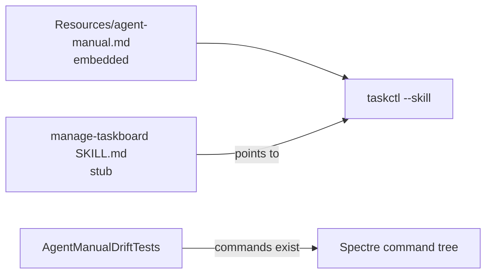

# SPEC-20261104-cli-agent-manual: `taskctl --skill` self-manual + stub skill + drift check

## 0. SPEC Metadata

| Field | Value |
|---|---|
| Feature name | CLI agent manual — `taskctl --skill` embedded manual, stub skill, drift check |
| Product / System | agent-harness (Harness) |
| Module / Bounded Context | CLI + Skills + CI |
| Change type | Feature (hygiene/dx) |
| Repository | afonsoft/agent-harness |
| Suggested branch | `feat/cli-agent-manual` |
| Technical owner | afonsoft |
| Status | `Draft` |
| Date | 2026-11-04 |
| Depends on | — |
| Related SPECs | SPEC-009-skill, SPEC-20261101-taskctl-skill-cli-sync (drift problem this kills structurally), SPEC-20261104-agent-context-templates (callback verbs documented by the manual) |
| Reference | COMPARISON-20261104-herdr-agent-runtime §4 — `hc --skill` prints embedded manual; installable skill = stub pointing at it |

## 1. Executive Summary

### Problem

`manage-taskboard/SKILL.md` documents the taskctl/agent surface in Markdown —
duplicated knowledge that drifts (that's exactly what
SPEC-20261101-taskctl-skill-cli-sync patch-fixes). Herdr's pattern removes the
drift at the source: `hc --skill` prints the agent manual **embedded in the
binary** (`crates/herdr-core/src/SKILL.md` compiled in), and the installable
skill is a ~10-line stub that only says *when* to use the tool and points to
`hc --skill`. Manual ships with the binary → always version-matched; the stub
almost never changes.

### Solution

1. `taskctl --skill` (alias `--agent-manual`) prints an embedded Markdown manual
   to stdout: coordination protocol, `taskctl agent *` verbs, delegation tools
   usage contract, error taxonomy, addressing rules — the same content an agent
   needs to operate the harness correctly.
2. `.claude/skills/manage-taskboard/SKILL.md` (and mirrors) becomes a stub:
   frontmatter `name/description` (when-to-use only) + "run `taskctl --skill`
   and follow it; outside a managed run, `taskctl` is the CLI."
3. CI drift check: `taskctl --skill` output is generated from the embedded
   source `src/Taskboard.Cli/Resources/agent-manual.md`; a test asserts the
   installed skill stub still points at the right command and the manual's
   documented commands exist in the CLI command tree (reflection over
   Spectre.Cli registrations).

### Out of scope

- Publishing the manual to remote skills catalogs; multi-language manual.
- Auto-generating the manual body from the method table (the bigger
  single-source refactor — see comparison doc watchlist); the manual is
  hand-maintained but embedded + existence-checked.

## 2. Requirements

### Functional

- **RF-001 Embedded manual.** `src/Taskboard.Cli/Resources/agent-manual.md`
  compiled via `EmbeddedResource`; `taskctl --skill` writes it verbatim to
  stdout (pipe-friendly, no ANSI when redirected). Sections: identity/env
  (`HARNESS_*` block), run/attach/send/wait/read/interrupt verbs (as they land),
  `taskctl agent *` callback surface, delegation DAG/mailbox protocol
  (contract-v2 rules: delivery/ack, ask/reply, gates), templates usage, error
  kinds + exit codes, "report results by file path for long outputs",
  envelope/provenance meaning.
- **RF-002 Stub skill.** `manage-taskboard/SKILL.md` rewritten: when-to-use
  description + preflight (`test -n "$HARNESS_SESSION_ID"` → managed context
  vs operator context) + "the installed binary is the authority — run
  `taskctl --skill`". All command tables move into the embedded manual.
- **RF-003 Drift check.** Test `AgentManualDriftTests`: (a) every command the
  manual references under `taskctl` resolves in the Spectre command tree;
  (b) every `error.kind` literal in the manual exists in the error taxonomy;
  (c) skill stub contains `--skill` pointer and no stale command tables
  (regex guard); (d) manual length <48KB (read-tool cap convention).
- **RF-004 Version stamp.** Manual header carries `taskctl` version;
  `--skill --json` optional machine-readable `{version, commands[], errorKinds[]}`
  for tooling.

### Non-functional

- `--skill` must work offline with zero server dependency (pure local print).
- Manual language: English, terse, imperative (agent-facing contract).

## 3. Architecture

- `src/Taskboard.Cli/Resources/agent-manual.md` + `--skill` flag on the root
  command (and `agent --skill` for the callback-only subset).
- Tests project: `Taskboard.Cli.Tests/AgentManualDriftTests.cs`.
- `.claude/skills/manage-taskboard/SKILL.md` stub (and sync to mirrors via the
  existing skill-sync flow, not by hand).

## 4. Security

- Manual contains no environment-specific values (no URLs/tokens); env vars are
  documented by name only.

## 5. Tests

- `--skill` prints manual containing required section anchors; `--skill --json`
  emits parseable `{version, commands[]}`.
- Drift tests per RF-003 — a removed `taskctl` command or renamed error kind
  breaks the build until the manual is updated.

## 6. Acceptance Criteria

- [ ] `taskctl --skill` prints the complete agent manual offline.
- [ ] `manage-taskboard` skill is a stub that defers to `--skill`; no duplicated
      command tables remain.
- [ ] Removing a CLI command or error kind fails `AgentManualDriftTests`.
- [ ] SPEC-20261101-style drift cannot recur silently — the manual lives in the
      binary and the skill cannot drift from it.
