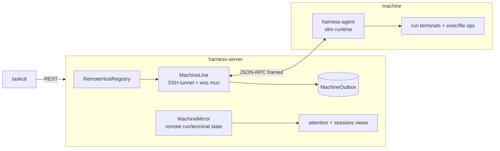

# SPEC-20261104-remote-ops-machines: taskctl exec/file/put + SSH machine bootstrap + remote runs

## 0. SPEC Metadata

| Field | Value |
|---|---|
| Feature name | Remote ops + machines — headless exec/file/put, SSH bootstrap, `--on` routing |
| Product / System | agent-harness (Harness) |
| Module / Bounded Context | CLI + Server + Integrations (Remote) + Delegation routing |
| Change type | Feature |
| Repository | afonsoft/agent-harness |
| Suggested branch | `feat/remote-ops-machines` |
| Technical owner | afonsoft |
| Status | `Draft` |
| Date | 2026-11-04 |
| Depends on | SPEC-20261021-remote-hosts (paired-server model — this spec adds the lightweight path); SPEC-20261104-run-terminal-runtime |
| Related SPECs | SPEC-20261022-headless-one-shot (`taskctl run`), SPEC-20261020-agent-hibernation |
| Reference | COMPARISON-20261104-herdr-agent-runtime §3 — `hc machine add`, remote install, `machine/t` addressing, Line/Mirror/Outbox |

## 1. Executive Summary

### Problem

The remote-hosts draft assumes a **paired harness-server** on the other end — heavy:
the remote machine must already run our full stack. Herdr's model is lighter and
additive: `hc machine add user@host` handshakes over SSH and **installs/upgrades the
remote runtime on demand** (arch-detected binary copy or release download), then
every primitive gains `--on <machine>`: `run`, `exec`, `file read|write|edit`,
`put`. Remote terminals address as `machine/t7`; events mirror back over a
supervised framed channel (`Line`), with a per-peer `Outbox` when disconnected.

For us: a build server or GPU box should run delegated agents without hosting the
full Harness web app — and simple remote chores (`git diff` on the deploy box,
read a remote log) shouldn't need an agent at all.

### Solution

Two-tier remote model under one `RemoteHost` registry:

- **Tier A — paired server** (existing remote-hosts spec): full Harness on both
  ends, routing + reverse-channel. Unchanged.
- **Tier B — SSH machine**: `taskctl machine add user@host` verifies reachability
  and bootstraps a **harness-agent** (a slim server-side runtime bundle: terminal
  manager + dispatch executor + reporting client — no Blazor, no EF, config-free)
  installed under `~/.agent-harness/agent/` on the remote. Server keeps a
  supervised SSH tunnel / WebSocket line per machine; terminal/run events mirror
  back; offline machines get an outbox.

Ops surface on both tiers:

- `taskctl run/exec/file/put --on <machine|host>` — `exec` returns exit code +
  exact output; `file edit` is exact-replace, multi-pair atomic (all-or-nothing);
  `put` ships a local file beside a remote run's working dir.
- `delegate_task --on <machine>` routes dispatch through the machine's agent
  runtime; run terminals on machines address as `<machine>/<name>`.

### Out of scope

- Remote viewer stream relay into the Blazor terminal (phase 2 — first version
  mirrors state/events, `run_read` text only).
- Windows remote targets (SSH-unix only in v1), mDNS discovery, public relay.
- Migration of a live session between machines.

## 2. Requirements

### Functional

- **RF-001 Machine registry.** `RemoteHost` gains `Kind(machine|server)`;
  `taskctl machine add <user@host> [--name n] [--via <cmd>]` → handshake
  `harness-agent connect` over SSH; missing/incompatible agent → offer
  `--install` (or auto when `--yes`): detect remote OS/arch, copy the matching
  published `harness-agent` artifact or build output, write to
  `~/.agent-harness/agent/`, spawn detached, verify protocol generation.
  `machine ls/remove/status`.
- **RF-002 Line.** Supervised connection per machine (SSH tunnel carrying
  WebSocket, or direct wss when reachable): multiplexes RPC calls, event mirror,
  heartbeat + reconnect (`keep_up`); remote run/terminal state appears in local
  `delegate_status`/sessions views tagged `machine:<name>`.
- **RF-003 Outbox.** Local server keeps `MachineOutboxEntry` per machine for
  messages dispatched while the line is down; flushed in order on reconnect
  (join drains outbox). Remote agent keeps its own outbox for status reports
  during disconnect; both survive restarts (SQLite-lite file beside the agent).
- **RF-004 exec.** `taskctl exec --on <m> --cwd <dir> <cmd>` — no terminal;
  returns `{exitCode, stdout, stderr}` exact; `-i` feeds piped stdin; timeout
  default 180s (process keeps running remote-side on timeout? No — exec kills on
  timeout; long-running → `run --bg`).
- **RF-005 file.** `taskctl file read --on <m> <path> [--offset --limit]`,
  `file write --on <m> <path>` (stdin→file, mkdir -p),
  `file edit --on <m> <path> --old <t> --new <t>` (repeatable pairs, atomic:
  all edits or none; `edit_failed` when old text matched ≠1 time).
- **RF-006 put.** `taskctl put --on <m> <local-file> [--dest <dir>]` → copies to
  the machine (default beside a referenced run's cwd with `--to <run>`), prints
  remote destination.
- **RF-007 Remote runs.** `delegate_task --on <m>` / `taskctl run --on <m>`:
  dispatch executes on the machine's agent runtime (env block +
  `HARNESS_API_URL` pointing through the line); states mirror back so
  attention/notes/lineage specs work unchanged. Addressing:
  `<machine>/<taskId-or-name>` accepted anywhere a task target resolves.
- **RF-008 Capabilities.** Machine advertises `{agents[], worktrees, exec,
  fileOps}` at handshake; routing refuses unsupported ops with `kind:
  capability_missing`.

### Non-functional

- `exec` output cap 1MB (truncated + flag); `file read` page ≤512KB/call.
- Line reconnect: exponential backoff 1s→60s; >5min down marks machine
  `disconnected` (runs keep running remote-side; mirror resumes).
- SSH auth via user's ssh config/agent only — no password handling; `--via`
  arbitrary transport command (like herdr) for jump hosts.

## 3. Architecture

- `src/Taskboard.Integrations/Remote/` — `MachineRegistry`, `MachineLine`
  (SSH via `SshClient`-style managed lib or `ssh` subprocess control-master —
  decide in implementation), `MachineMirror`, `MachineOutbox`.
- `src/Taskboard.AgentHost/` (new slim host) — `harness-agent` binary:
  `connect`, `serve`, exec/file/run RPC handlers; shares Contracts +
  Execution/Terminal code, no EF/Blazor.
- `src/Taskboard.Cli/Commands/` — `machine`, `exec`, `file`, `put` commands;
  `--on` plumbing into existing `run`/delegation calls.
- EF migration: `RemoteHosts.Kind`, `MachineOutboxEntries` table.

## 4. Security

- Remote agent binds loopback on the remote; all traffic flows through the
  authenticated line — no open remote ports.
- `file`/`exec` ops execute as the SSH user on the remote — documented; no sudo
  escalation paths added.
- `put` rejects paths escaping the run's workspace root (same worktree guard).
- Machine grants revocable: `machine remove` invalidates the agent token and
  kills the line; remote agent exits on revoked token.
- Outbox payloads encrypted at rest? Phase 2 — v1 treats them like mailbox rows
  (local user file, 0600).

## 5. Tests

- `MachineRegistryTests` — add/handshake/install flow against a fake SSH
  transport; name derivation/dedup (`host`, `host-2`); capability gating.
- `LineTests` — RPC call/reply, heartbeat timeout→disconnected, reconnect drains
  outbox in order; mirror applies remote events.
- `RemoteOpsTests` — exec exit code/output; file edit atomic multi-pair +
  `edit_failed`; put path validation.
- `RemoteDispatchTests` — `delegate_task --on` executes on fake remote runtime;
  states mirror into local status; `machine/<id>` addressing resolves.
- Integration (opt-in, needs sshd localhost) — real `machine add localhost`
  end-to-end.

## 6. Acceptance Criteria

- [ ] `taskctl machine add <ssh-host> --install` bootstraps `harness-agent` and
      `machine ls` shows it connected.
- [ ] `taskctl exec --on <m> git -C /repo diff` prints exact output + exit code.
- [ ] `taskctl file edit --on <m>` applies all `--old/--new` pairs atomically.
- [ ] `delegate_task --on <m>` runs the agent on the machine; its attention
      states and notes appear locally; killing the line keeps the remote run
      alive and resyncs on reconnect.
