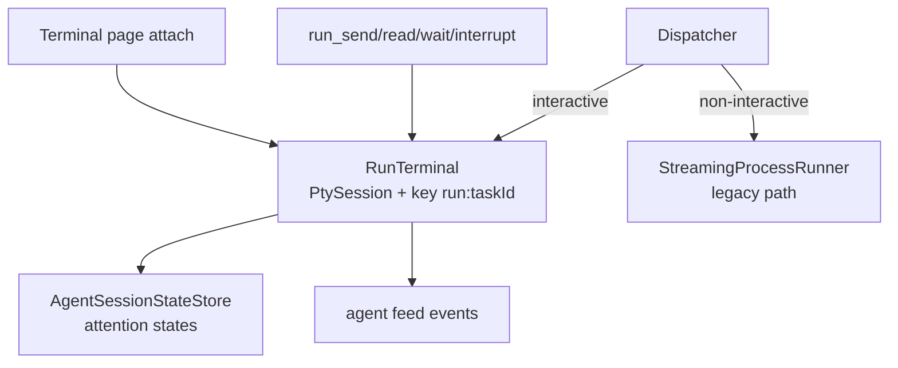

# SPEC-20261104-run-terminal-runtime: delegated runs as persistent steerable terminals

## 0. SPEC Metadata

| Field | Value |
|---|---|
| Feature name | Run Terminal Runtime — delegated agents in attachable interactive terminals |
| Product / System | agent-harness (Harness) |
| Module / Bounded Context | Integrations (Execution/Terminal) + Application + Server + Chat tools + Blazor |
| Change type | Feature (architectural) |
| Repository | afonsoft/agent-harness |
| Suggested branch | `feat/run-terminal-runtime` |
| Technical owner | afonsoft |
| Status | `Draft` |
| Date | 2026-11-04 |
| Depends on | SPEC-20261005-delegation-dag-mailbox (Done); PTY infra (`PtySession`, `TerminalSessionManager`) |
| Related SPECs | SPEC-20261020-orchestration-contract-v2 (Dispatch lifecycle), SPEC-20261020-agent-attention-model, SPEC-20261104-agent-attention-manifests, SPEC-20261104-agent-lineage-notes |
| Reference | COMPARISON-20261104-herdr-agent-runtime §1.1–1.3, §4 — herdr-core `hc run/send/wait/read/interrupt/attach` |

## 1. Executive Summary

### Problem

A delegated run today is a **one-shot process**: `StreamingProcessRunner` spawns the CLI
with a composed prompt, streams stdout to a log buffer, and the only lifecycle verbs are
cancel/kill. Consequences:

- No mid-run steering — an agent stuck on a permission prompt can only be killed, never
  answered. A blocked leg of a DAG is dead weight instead of a question to resolve.
- No multi-turn — follow-up work needs a new run that re-explains context; the herdr
  rule applies to us too: agents must stay *watchable, steerable, and available for
  another turn*.
- No human takeover — the run's output is a log, not a terminal; the user cannot open
  the agent's session in the Terminal page, type, and hand control back.
- No output-targeted waits — coordination is fixed-interval polling of run state;
  "wait until it prints `listening on`" doesn't exist.

### Solution

Introduce **RunTerminal**: every dispatch executes inside a persistent PTY session owned
by the runtime (reusing `PtySession`/`TerminalSessionManager` infra), keyed by
`run:<taskId>`/dispatchId. Add chat/MCP tools `run_send`, `run_read`, `run_wait`,
`run_interrupt`; keep `StreamingProcessRunner` as a compatibility path for CLIs/defs
marked non-interactive. Human attach = existing Terminal page session attach + a
control-ownership flag (`Operator|Human`) so the UI can type without breaking the
orchestrator's authority model.

### Expected outcome

- `delegate_task` dispatch → interactive agent CLI in a `RunTerminal` (no `-p`/one-shot
  flags; CLIs without an interactive mode keep the streaming path).
- Tools: `run_send {target, text, wait?}`, `run_read {target, lines?, source?}`,
  `run_wait {target, state?, output?, timeout?}`, `run_interrupt {target}`.
- `run_wait --output <regex>` matches only output emitted **after** the wait starts;
  returns `{reason: state|output|message|timeout|exited}` — timeout is a check-in.
- Blocked runs are first-class: `run_send` refuses while status=`blocked` unless
  `force: true` (never used to bypass a permission decision).
- Terminal page can attach any run terminal (multi-viewer); human typing sets
  `ControlOwner=Human` until detach → orchestrator `run_send` warns, doesn't hard-fail.
- Structured agent-surface errors `{kind, message, hint}`: `not_found`,
  `needs_target`, `blocked`, `status_mismatch`, `finished`, `not_started`,
  `delivery_failed` — report what was observed, never what was assumed.

### Out of scope

- Screen-heuristic detection itself (SPEC-20261104-agent-attention-manifests consumes
  the same PTY stream).
- Crash recovery/`keep` semantics and terminal adoption across server restart
  (hibernation spec + future candidate).
- Nested depth >1 delegation inside run terminals (contract-v2 scope).

## 2. Requirements

### Functional

- **RF-001 RunTerminal entity/record**: `Id`, `TaskId`, `DispatchId?`, `PtySessionId`,
  `CliName`, `State(live|finished)`, `Status` (reported/attention states from the
  attention layer), `ControlOwner(operator|human)`, `CreatedAtUtc`, `FinishedAtUtc?`,
  `ExitCode?`. One active RunTerminal per dispatch; retained after finish for `read`.
- **RF-002 Interactive dispatch**: `DelegationDispatcherService` resolves adapter;
  when the CLI supports interactive mode (manifest `interactive: true`, default for
  claude/devin/codex/opencode/gemini/agy) the dispatch spawns a `PtySession` running
  the CLI with its **launch argv** (not a `-p` one-shot), waits for readiness signal
  (attention state `idle` or manifest readiness rule, ≤60s, one settle retry), then
  sends the task text. Delivery is recorded as `FirstMessage {sent, reason?}` on the
  dispatch — durable, inspectable after restart.
- **RF-003 run_send**: resolves target (taskId | dispatchId | run terminal name);
  writes text as terminal input. `--wait` blocks until the turn advances past
  delivery or a `not_started`/`delivery_failed` outcome — never silently resends;
  caller must `run_read` first after a failed send.
- **RF-004 run_read**: `{screen}` snapshot (current viewport) or `--lines N` history;
  while status is `working|blocked|error`, history reads return screen only with
  `incomplete: true, why: <status>` (no scroll input injected into a live agent).
- **RF-005 run_wait**: `run_wait {target, state?, output?, timeout=180s}` — server-side
  wait on the run terminal: `state` matches attention-store transition, `output` is a
  regex matched against bytes emitted after wait registration. Returns
  `{reason, state?, matched?}`. `reason: message` means a mailbox/notes delivery
  interrupted the wait — the message arrives as the caller's next inbox item.
- **RF-006 run_interrupt**: sends the CLI's interrupt sequence (Ctrl+C / Esc per
  manifest) to stop the current turn without killing the process; refused on
  `finished` terminals.
- **RF-007 Human attach**: `TerminalSessionManager` attaches the Blazor terminal to the
  run's PTY (second viewer). First human keystroke flips `ControlOwner=human`; detach
  returns to `operator`. While `human`, `run_send` returns error
  `status_mismatch` with hint "a person is driving this terminal".
- **RF-008 Compat path**: `AgentCliDefinition.Interactive == false` (custom defs,
  one-shot-only CLIs) keeps `StreamingProcessRunner`; `run_*` tools on such runs
  return `kind: unsupported` with hint. Delegation contract unchanged.
- **RF-009 Error taxonomy**: all run tools return `{error:{kind,message,hint}}`;
  kinds: `not_found`, `needs_target`, `blocked`, `status_mismatch`, `finished`,
  `not_started`, `delivery_failed`, `unsupported`, `timeout`.
- **RF-010 Inspection**: `GET /api/local/runs/{id}/terminal` → RunTerminal snapshot
  (state, status, controlOwner, firstMessage); feed events on attach/detach and
  control-owner flip.

### Non-functional

- PTY scrollback per run capped (existing session defaults); `run_read` response ≤64KB.
- `run_wait` holds no locks; internal poll ≤1s + mailbox/notes wake subscription;
  max `timeout` 600s; concurrent waits per run ≤8.
- Killing the PTY reaps the whole process tree (`IProcessTreeSignaler` path) and marks
  the run `finished` with exit code; orphan sweep reuses heartbeat-stale rules.

## 3. Architecture

- `src/Taskboard.Domain/Agents/RunTerminal.cs` (+ `RunTerminalStatus`,
  `ControlOwner`, `FirstMessage` VO).
- `src/Taskboard.Application.Contracts/Agents/IRunTerminalService.cs` — attach,
  send, read, wait registration, interrupt, ownership.
- `src/Taskboard.Integrations/Agents/RunTerminalService.cs` — bridges
  `TerminalSessionManager`/`PtySession`; wait registry (regex + state predicate);
  integrates `IAgentAttentionService` for state matching.
- `src/Taskboard.Integrations/Chat/Tools/Runs/` — `run_send`, `run_read`, `run_wait`,
  `run_interrupt` tools with shared target resolution (`DelegationToolSupport`).
- Dispatcher: `IAgentAdapter.BuildInteractiveCommand(request)` next to
  `BuildCommand`; `CliCapabilities.Interactive` flag on cli map/defs.

## 4. Security

- `run_send`/`run_interrupt` require the run's scope membership (same as mailbox).
- Human attach requires authenticated web session + run ownership or Admin.
- Raw PTY bytes pass through `ISecretRedactor` before entering tool responses and
  archived reads; `run_read` never returns env values (env injection is the
  context-templates spec's scoped token, redacted in echoes).
- `force: true` on `run_send` is logged to the feed with actor identity.

## 5. Tests

- `RunTerminalServiceTests` — dispatch→ready→first-message delivery record;
  send on booting agent → `not_started`; send while blocked → refusal;
  send while `ControlOwner=human` → `status_mismatch`.
- `RunWaitTests` — output regex only matches post-registration bytes; state wait on
  transition; timeout returns `reason: timeout`; mailbox delivery → `reason: message`.
- `RunReadTests` — history read while `working` returns screen + `incomplete/why`.
- Dispatcher integration — interactive CLI (fake PTY agent emitting OSC status)
  completes a turn; non-interactive def takes legacy path unchanged.
- Tool tests — error taxonomy kinds on each refusal path.

## 6. Acceptance Criteria

- [ ] A delegated task runs an interactive agent session visible in `delegate_status`
      with a `terminal` handle.
- [ ] `run_send` mid-run text reaches the agent; a blocked agent refuses send
      without `force`.
- [ ] `run_wait --output "ready"` resolves on post-wait output; timeout returns a
      check-in, not a failure.
- [ ] A human can attach the run terminal, type, detach; orchestrator sees the
      ownership flip in status/feed.
- [ ] After the run finishes, `run_read` still returns archived output.
