# Harness

[](https://github.com/afonsoft/agent-harness/actions/workflows/dotnet.yml)
[](https://github.com/afonsoft/agent-harness/actions/workflows/code-quality.yml)
[](https://github.com/afonsoft/agent-harness/actions/workflows/codeql.yml)
[](LICENSE)

> **Default language:** English (en-us). See [README.pt-br.md](README.pt-br.md) for the Portuguese version.

**Harness** is a local-first, AI-native workbench for orchestrating AI coding agents — built on **C# 14 / .NET 10**. The repository is `agent-harness` (formerly `taskboard-ai`); internal technical identifiers keep the `taskboard` name (namespaces, projects, `taskctl` CLI, `Taskboard:*` config section); operational env vars use `HARNESS_*` and the install home is `~/.agent-harness` (legacy `TASKBOARD_*` envs are no longer read — see the migration note below).

## Overview

Harness turns GitHub issues into a Kanban board driven by AI agent CLIs. It provides a SQLite-backed task system, REST API, Server-Sent Events (SSE), a `taskctl` CLI, an MCP server, AI chat integration, a multi-tab terminal, an embedded VS Code web editor (code-server), and a Blazor WebAssembly UI — all implemented in .NET 10 with ABP N-Layer / DDD.

Key capabilities:

- **GitHub Kanban board** — label-backed columns, drag & drop, priorities, markdown bodies, issue comments (post from the UI straight to GitHub), and a unified per-issue history timeline (board mutations + agent runs).
- **Agent orchestration** — run any of 13 agent CLIs (Devin, Claude Code, Codex, OpenCode, Antigravity, Kimi, Grok, Aider, Cline, Continue, Copilot, Qwen, Kiro) against an issue, with per-issue prompts, a `Comments:` handoff section auto-appended to the prompt, SignalR log streaming, and persistent run history.
- **ADE pipelines & Cockpit** — multi-stage, multi-agent DAG pipelines (`POST /api/harness/runs`, templates at `/api/harness/pipelines`) driven from a live HITL cockpit at `/cockpit` (`/cockpit/runs/{id}`): structured timeline events, steer messages mid-flight, approval gates, git diff viewer, and create-PR on success.
- **Workspace isolation** — every agent run executes inside a dedicated Git worktree under `{worktreeRoot}/{runId}` — `Taskboard:WorktreeRoot`, default `~/repos` — (create/diff/commit/teardown via `POST|GET|DELETE /api/harness/worktrees`), never directly on your checkout.
- **Agent delegation** — the AI Code chat can decompose work into a `DelegationTask` DAG (`delegate_task`/`delegate_fanout`/`delegate_status`/`delegate_compare` tools): dependency-driven `pending→ready` promotion, stale-base guard, retry-of, a hosted dispatcher capped at 4 concurrent runs, and fan-out of the same prompt to N CLIs in parallel worktrees with diff comparison.
- **Agent mailbox** — typed inter-agent messages (`text`/`worker_done`/`heartbeat`/`escalation`/`decision`) routed by scope and recipient (`@all`, `@idle`, cli, task); `agent_send`/`agent_inbox` chat tools, escalation and decision messages surface in the dashboard's **Needs You** column.
- **Agent Dashboard** — `/agents` shows a Needs You / Working / Done / Idle board (`GET /api/local/delegation/dashboard`) aggregating tasks, runs, mailbox alerts and idle CLIs.
- **CLI session resume** — `/agents` scans on-disk transcripts (`~/.claude/projects`, `~/.codex/sessions`, opencode store) via `GET /api/agents/sessions` and offers one-click resume (`claude --resume`, `codex resume`, `opencode --session`) through the terminal.
- **Worktree checkpoints** — `harness-checkpoint:` prefixed commits snapshot and restore worktree state mid-run (`worktree_checkpoint`/`worktree_checkpoints` tools).
- **Workspace picker** — Agent chat runs tools against a chosen folder (default `~/repos`, any subfolder selectable); per-conversation, sandboxed to `$HOME`.
- **Devin-style chat workspace** — the AI Code chat docks a live workspace panel beside the transcript (Tasks / Changes / Terminal PTY / Editor / Plan / Preview / Browser tabs, drag-resizable, persisted per conversation), plus a ⌘K command palette, run pause/resume/stop controls, risk-tiered auto-approvals, git bar with PR links, preview tab with element-picker → composer quote, `browser_use` tool with a shot gallery, post-run next-action suggestion chips, and voice dictation.
- **Verification loop** — opt-in deterministic build/test/coverage gate after each agent run (`dotnet format → build → test` with TRX + coverage parsing); failures feed a retry loop with a structured `feedbackPrompt` and escalate to human after max attempts.
- **Security gateway** — pre-dispatch command classification (Safe/WorkspaceWrite/Dangerous, fail-closed), path-jail + symlink-escape enforcement, and secret scrubbing on logged output.
- **Context & memory** — hierarchical context compilation (`AGENTS.md`/`CLAUDE.md`/`.cursorrules`, env + git block, token-budgeted compaction) and project memory items scoped by remote origin.
- **CLI metrics** — incremental, read-only ingestion of the agent CLIs' own SQLite stores (session counts, tokens, last activity per CLI on `/agents`, watermark cursors, drift detection, 90-day raw retention with permanent daily aggregates), plus a FinOps-ready usage feed.
- **Global repository selector** — a single repo combo in the sidebar (`harness.selectedRepo`) drives every repo-scoped surface: Board, Gantt, Workflow, Specs, Terminal (new PTY tabs open in `repos/[selected]`) and the VS Code workdir.
- **Living Specs** — `/specs` renders the selected repository's `.specs/` catalog with status tracking, plus a spec-drift report (`GET /api/specs/drift-report`) comparing spec text against the code.
- **FinOps** — `/finops` aggregates per-run token/cost metrics across pipelines and agent runs.
- **Model tiers** — a Lite/Normal/Ultra selector per CLI maps to real models (e.g. Claude `haiku`/`sonnet`/`opus`, Codex `gpt-5.6-luna`, Devin `haiku`/`swe`/`opus`); CLIs without a model flag stay CLI-managed.
- **CLI Agents admin** — install/authenticate CLIs from the UI with terminal-style install logs; enable/disable per agent.
- **Skills & MCP/RAG settings** — install the `afonsoft/skills` catalog from the UI and provision a RAG MCP server (URL + key) into every supported agent config.
- **VS Code Web** — managed code-server at `/vscode/` (readiness-gated proxy, port forwarding via `VSCODE_PROXY_URI`), plus an "Open in VS Code" deep link per issue.
- **Terminal** — multiple interactive bash PTY tabs over SignalR, with **focus mode** (expand/restore hides the top bar and page chrome for a full-viewport shell, keeping a compact tab strip) and a **virtual keybar** shown only on touch devices in focus mode (arrows, Esc, Tab/Shift+Tab, Home/End/PgUp/PgDn, one-shot sticky Ctrl, and dedicated clipboard paste).

## Screenshots

| Board | AI Code |
|---|---|
| 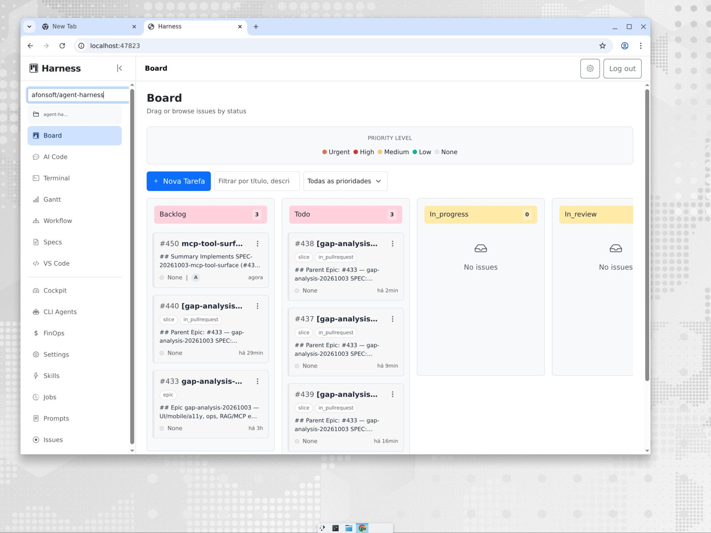 | 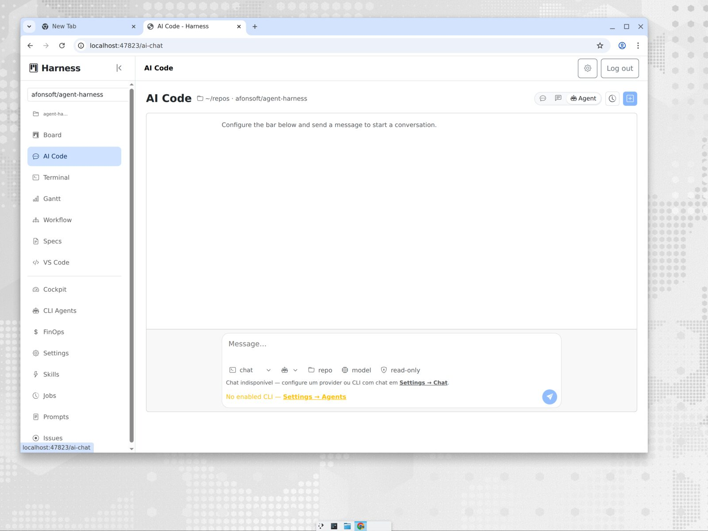 |
| **Living Specs** | **Jobs** |
| 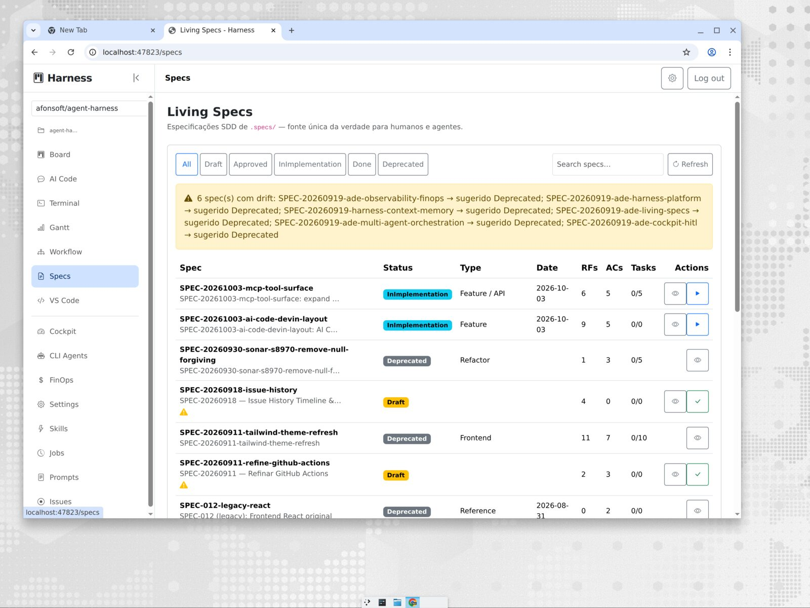 | 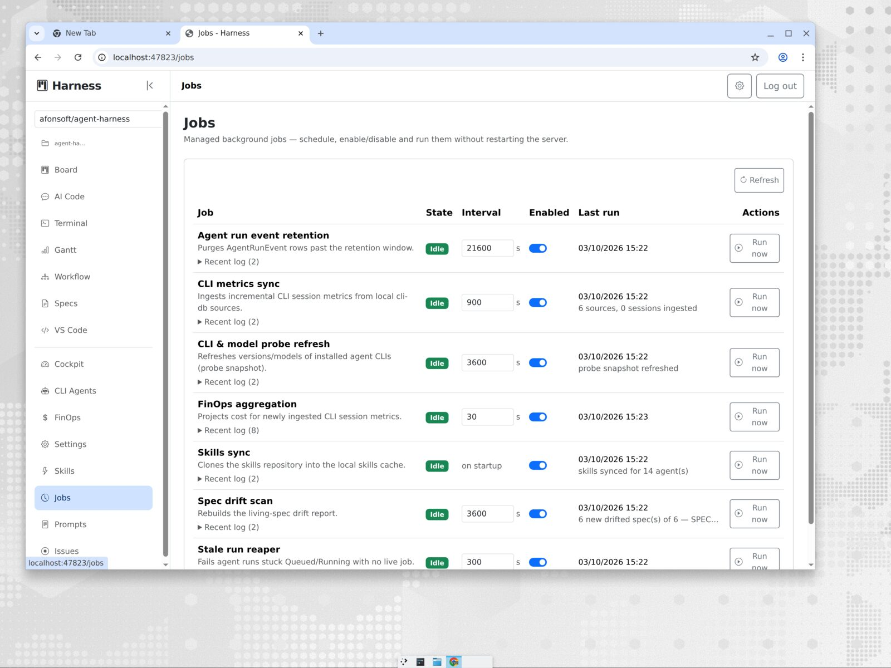 |
| **FinOps** | **CLI Agents** |
| 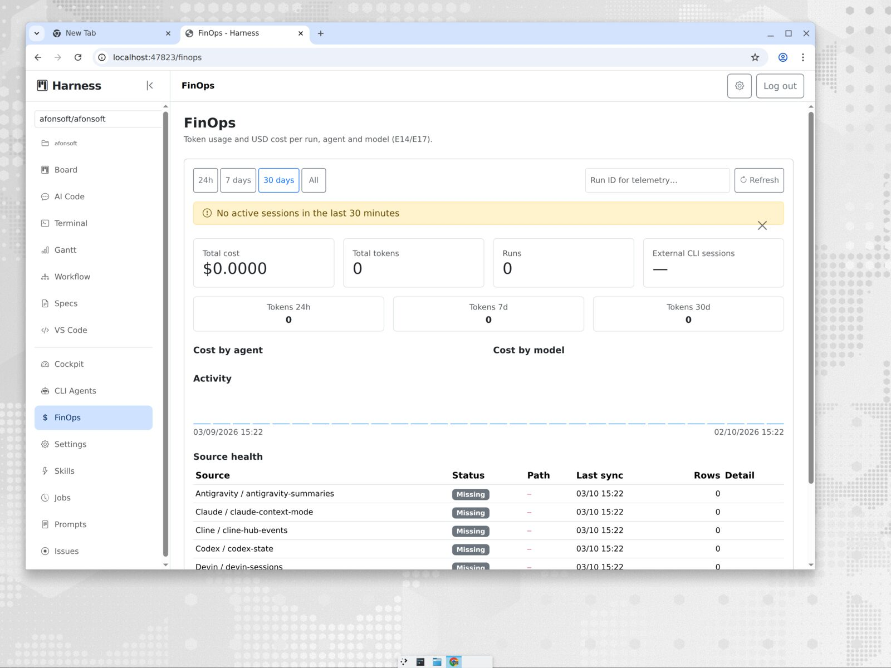 | 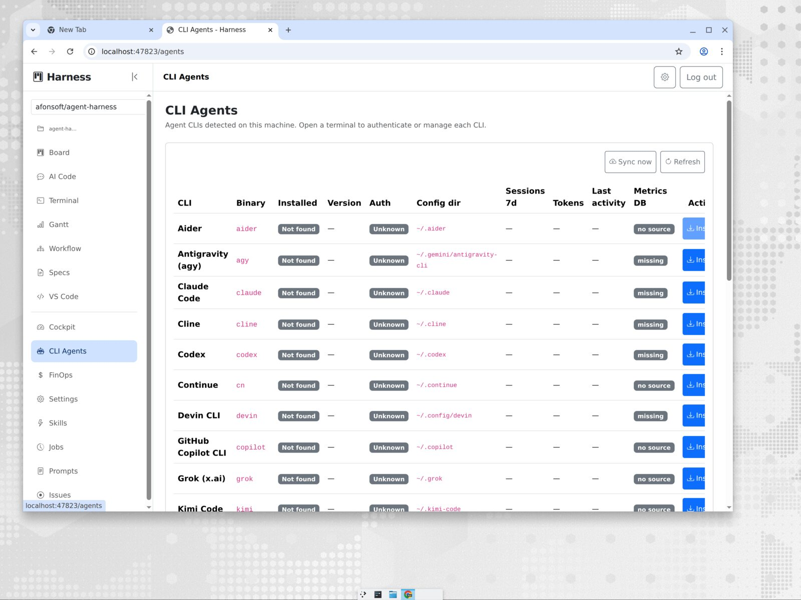 |
| **Terminal** | **Settings** |
| 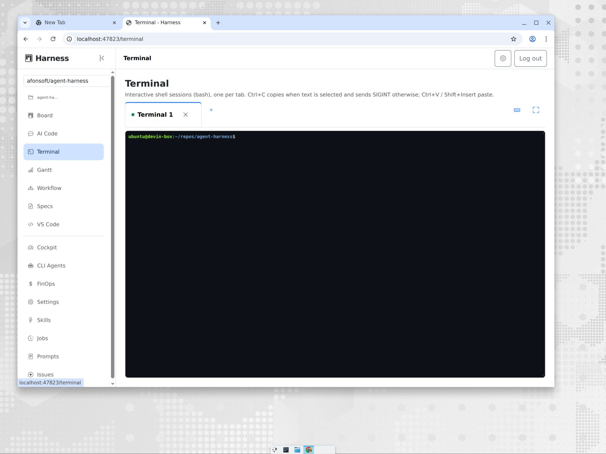 | 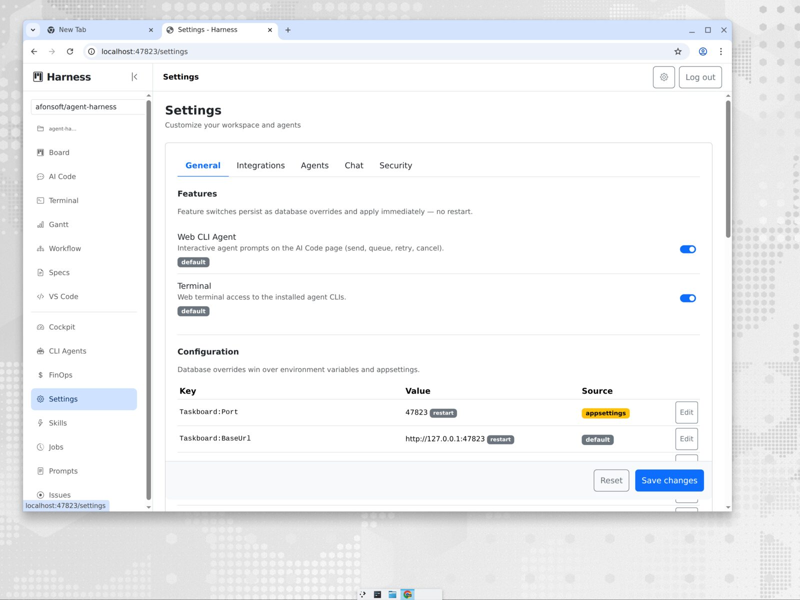 |
| **Agent Dashboard** | **Workspace picker** |
| 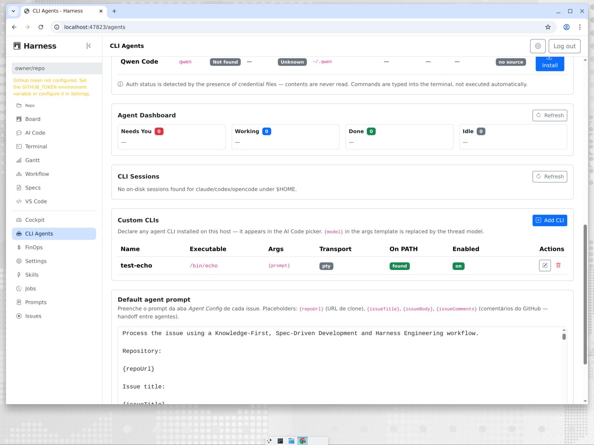 | 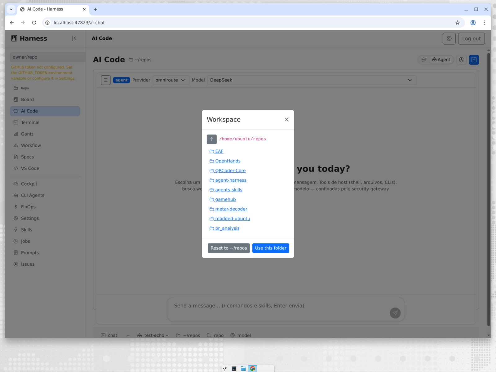 |
| **Chat command palette** | **Chat app preview** |
| 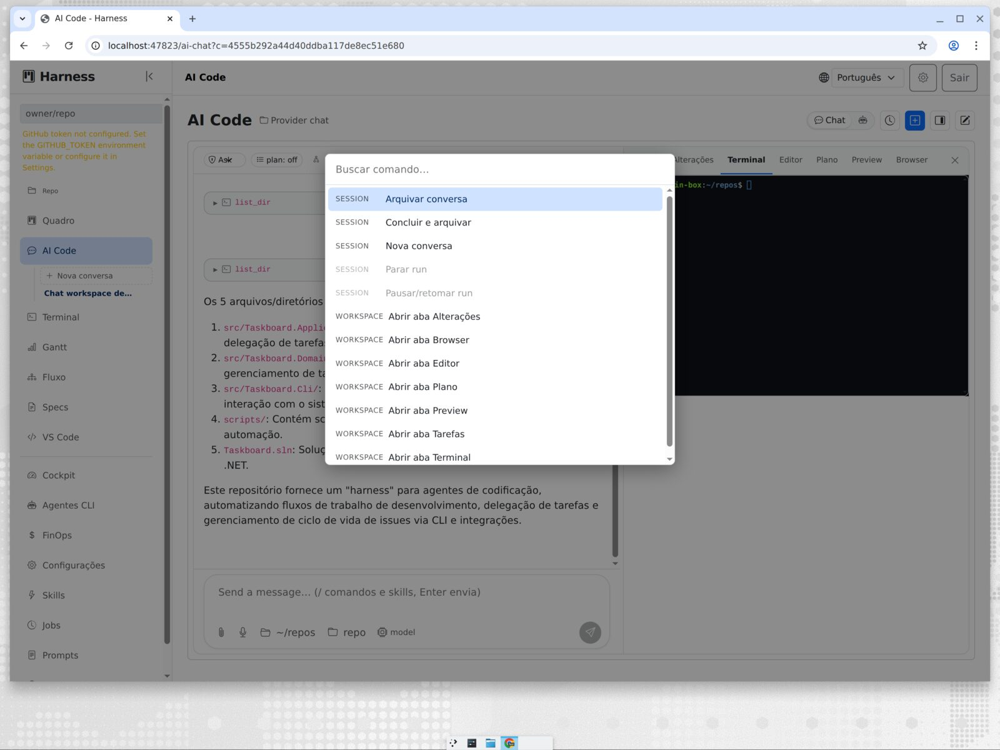 | 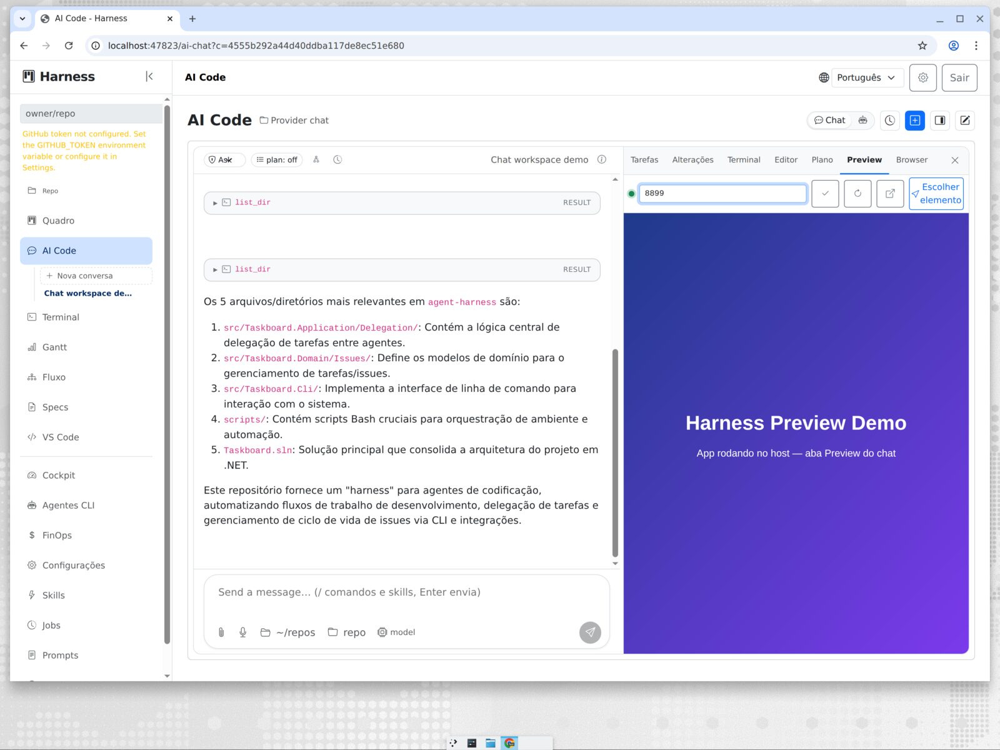 |
| **Chat overview** | **Mobile navigation** |
| 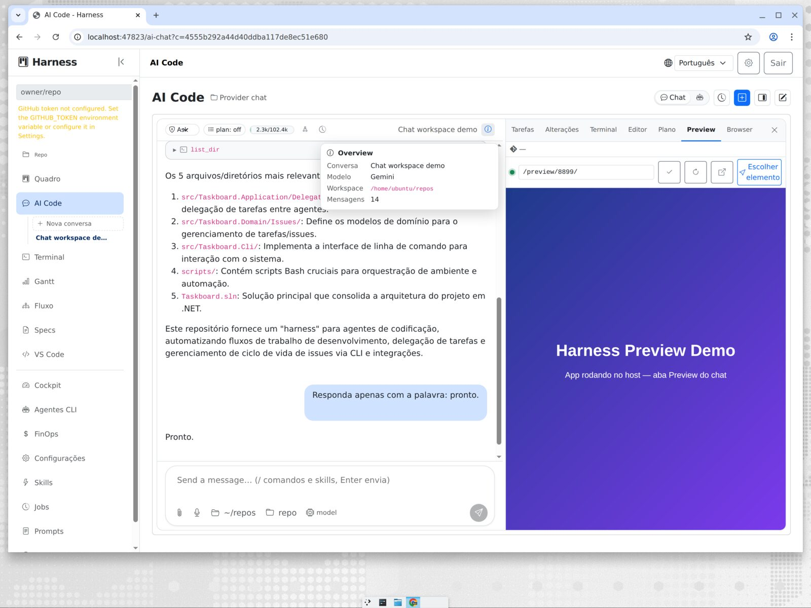 | 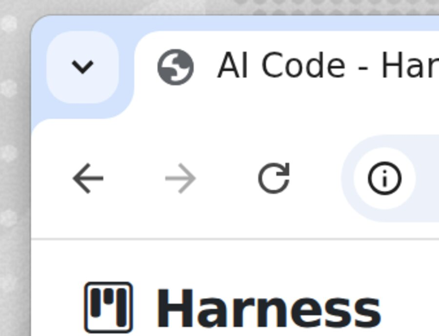 |

## Tech Stack

| Layer | Technology | Version |
|---|---|---|
| Language | C# | 14 |
| Runtime | .NET | 10.0 |
| Web Framework | ASP.NET Core | 10.0 |
| DDD Framework | ABP N-Layer | 9.x |
| ORM | Entity Framework Core | 10.0.12 |
| Database | SQLite | bundled |
| CLI Parser | Spectre.Console.Cli | 0.55.0 |
| MCP SDK | ModelContextProtocol | 2.2.0 |
| Tests | xUnit + Shouldly + NSubstitute | latest stable |
| Frontend | Blazor WebAssembly | .NET 10 |
| UI Components | Blazor.Bootstrap | 4.0.0 |
| Real-time | ASP.NET Core SignalR | 10.0 |
| GitHub API Client | Octokit | 14.0.0 |
| Mediator | MediatR | 12.4.1 |

## Architecture

```text
src/
  Taskboard.Domain/                 # Aggregates, entities, value objects, domain events
  Taskboard.Domain.Shared/          # Shared domain primitives
  Taskboard.Application.Contracts/  # DTOs, interfaces
  Taskboard.Application/            # Commands, queries, handlers (MediatR) + Harness pipeline engine
  Taskboard.EntityFrameworkCore/    # EF Core + SQLite + repositories
  Taskboard.Server/                 # ASP.NET Core Minimal APIs + SSE + SignalR hubs
  Taskboard.Cli/                    # taskctl CLI (Spectre.Console.Cli)
  Taskboard.Mcp/                    # MCP server (ModelContextProtocol SDK)
  Taskboard.AiChat/                 # AI chat threads/runs/events
  Taskboard.Cloud/                  # Cloud companion + sync
  Taskboard.Integrations/           # GitHub, Jira, agent CLIs, worktrees, security gateway, verification, PTY, code-server
  Taskboard.Maui/                   # Optional desktop Blazor Hybrid
  Taskboard.Client/                 # Blazor WebAssembly host (WASM boot, loading UI)
  Taskboard.Blazor/                 # Shared Blazor UI components (RCL)
tests/
  Taskboard.Tests.Unit/             # 1,550+ unit tests
  Taskboard.Tests.Integration/      # 315+ integration tests
```

## Quick Start

```bash
git clone https://github.com/afonsoft/agent-harness.git
cd agent-harness
dotnet restore Taskboard.sln
dotnet build Taskboard.sln
dotnet test Taskboard.sln
dotnet run --project src/Taskboard.Server
```

See [`docs/installation.md`](docs/installation.md) for detailed setup, environment variables, and troubleshooting.

## CLI Installer

Install the `taskctl` CLI to `/usr/local/bin`:

```bash
./install-cli.sh
```

See [`install-cli.sh`](install-cli.sh) and [`docs/installation.md`](docs/installation.md) for details.

## Continuous Integration

GitHub Actions provide:

- Build and test in Release mode, format verification, a line-coverage gate (currently 80%, ratcheting toward the 90% target) plus a branch-coverage floor, and vulnerable-package checks.
- SonarCloud analysis when the `SONAR_TOKEN` secret is configured.
- CodeQL analysis for C# and GitHub Actions.
- Weekly NuGet and GitHub Actions updates through Dependabot.

## GitHub Kanban & AI Agents

Set `GITHUB_TOKEN` before starting the server:

```bash
export GITHUB_TOKEN=your-github-token
```

Open the **Board** (`/`) to view GitHub issues as a Kanban board. Drag an issue to **In Progress**, pick an agent CLI and model tier, and follow execution in the **Logs** tab. Real-time agent logs are streamed through the SignalR hub at `/agent-log-hub`.

## Recent Highlights

- Agent-delegation wave (P1–P3): workspace picker in AI Code, enriched CLI registry with custom-CLI delegation and probe-based model discovery, `DelegationTask` DAG + agent mailbox + hosted dispatcher + parallel fan-out, Agent Dashboard, CLI session resume, worktree checkpoints and a decision gate.
- AI Code modes consolidated: **Chat** and **Agent** (provider chat + CLI delegation via `run_agent`/`run_cli`); Assistant mode removed.
- ADE platform wave E12–E16 shipped: multi-agent DAG pipelines with HITL cockpit (`/cockpit`), living specs (`/specs` + drift report), FinOps metrics (`/finops`), a global repository selector driving all repo-scoped pages, and repository renamed to `agent-harness`.
- Agent Development Environment (ADE) harness epics E6–E11 shipped: isolated Git worktrees per run, context compilation + project memory, a security gateway for pre-dispatch command gating, a deterministic verification loop, a read-only CLI DB reader, and persisted CLI usage metrics with a `/agents` dashboard row.
- Lite/Normal/Ultra model tiers mapped to real models per CLI.
- GitHub issue comments as the agent handoff channel (UI tab + auto `Comments:` prompt section + MCP/taskctl).
- Unified issue history: board mutations + agent runs in one timeline.
- VS Code Web (managed code-server) with per-issue deep links and port forwarding.
- Multi-tab PTY terminal and CLI Agents admin page with install logs.
- Terminal mobile UX (E23): focus mode expands the shell to the full viewport (top bar and page chrome hidden, compact tab strip kept) and a touch-only virtual keybar provides Esc, arrows, Tab/Shift+Tab, Home/End/PgUp/PgDn, sticky Ctrl and paste for phone keyboards.

## Compared to Orca

[Orca](https://github.com/stablyai/orca) is the closest reference point — a desktop/mobile **fleet manager for coding agents** (Electron + relay/cloud), where Harness is a local-first .NET **service** with the same orchestration heart. The 2026-10-20 gap analysis (`.specs/COMPARISON-20261020-orca-delegation-board.md`) drove eight migration specs — all shipped: board-v2, attention-model, orchestration-contract-v2, feed-notifications, session-history-parity, agent-hibernation, provider-quota-usage, worktree-shared-context. Re-analysis vs current `main` below:

| Capability | Orca | Harness | Status |
|---|---|---|---|
| Delegation contract | Run→Task→Dispatch→Delivery, ack FIFO, ask/reply, task-bound gates, retain/release, launch prefs | Same durable contract (orchestration-v2) | parity |
| Status detection | OSC titles + managed agent hooks + idle heuristics | Unified `AgentSessionState` store + Needs You | parity |
| Agent board | Kanban cards, filters, unread feed, deep-links | Board v2 + attention glyphs + feed w/ prefs+sound | parity |
| Hibernation | Auto-sleep done+idle ≥30min, resume-on-focus, guards | Same + Keep-alive pin, per-user threshold, stats | parity |
| Provider quota | Per-provider windows + status-bar warn @80% | api/cli/local collectors, hysteresis, plan limits UI | parity (no throttle) |
| Shared context | Settings + `orca.yaml` + `.worktreeinclude` + auto-detect | `.worktreeinclude` + `.harness/worktree.yaml` + config + auto-detect | parity |
| Worktree cards | `worktree set --comment --workspace-status` | `worktree_set_status` tool + card API + SignalR patch | parity (UI badge = P3) |
| Session stores | Per-CLI transcript scan + native resume | Scanner ×6 CLIs + index + search/resume parity | parity |
| Session restore | Daemon-owned PTYs survive quit + layout/scrollback restore | Detached PTYs + session index; no layout/scrollback persist | **partial** |
| CLI coverage | ~30 pickers, per-agent depth tiers (usage/hot-swap/hooks/status/history) | 13 pickers; deep tiers: usage claude/codex, hooks claude/codex, history ×6 | **pending** |
| Worktree setup | `scripts.setup`/`archive` + `wait-for-setup` + `--setup` flag; `defaultTabs`, `issueCommand`, `environmentRecipes` | Shared-path copy only — no setup commands | **pending** |
| Multi-account | Codex/Claude hot-swap: isolated homes, status-bar chip, per-account usage, config mirror | Single credential per provider | **pending** |
| Automations | prompt+provider+repo/workspace/project+host, `--precheck` probe, missed-run grace, `--reuse-session`, `--extra-agent-args` | Generic `/jobs` scheduler — not agent-targeted | **pending** |
| Remote hosts | Paired servers (`--on ssh:`/`runtime:`), revocable client tokens, `orca serve`, mobile QR pairing | Local only (Cloud module stub) | **pending** |
| Review | Per-line AI/human **attribution**, annotate-ai-diff, jira/linear | Diff viewer + compare + GitHub/jira | **pending** |
| Secrets | `ai-vault` + `ai-vault-search` | Plaintext token prefs | **pending** |
| Artifacts | Artifacts store (blob offload) | Deliverables metadata only | **pending** |
| Terminal | Tabs+panes+splits, ghostty/warp themes, per-terminal cgroup mem caps | Tabs (focus mode, touch keybar) | **partial** |
| Notifications | OS notifications + Dock badge + custom sound files | In-app feed + sound categories | **partial** |
| Computer use | `orca computer` — a11y-tree control of native apps | `browser_use` only | **pending** |
| Project groups | Multi-repo folder workspaces | Single-repo selector | **pending** |
| Mobile | Orca Mobile + QR pairing | Responsive Blazor | n/a |

**Remaining gaps, ranked** (post-reanalysis — each has a spec in `.specs/`): ① worktree **setup/archive scripts** + startup policy — `SPEC-20261021-worktree-setup-scripts`; ② **agent-targeted automations** (precheck, grace, reuse-session, extra-agent-args) — `SPEC-20261021-agent-automations`; ③ **multi-account hot-swap** for claude/codex — `SPEC-20261021-provider-account-hot-swap`; ④ **remote/federated hosts** + pairing — `SPEC-20261021-remote-hosts`; ⑤ **review surface** — per-line attribution + diff annotations — `SPEC-20261021-review-attribution`; ⑥ **artifact store** — `SPEC-20261021-artifact-store`; ⑦ **secrets vault** — `SPEC-20261021-secrets-vault`; ⑧ **quota-driven throttling** — `SPEC-20261021-quota-throttling`; ⑨ terminal splits + OS notifications — `SPEC-20261021-terminal-ux-notifications`; ⑩ project groups (`SPEC-20261021-project-groups`), CLI depth tiers (`SPEC-20261021-cli-depth-tiers`), computer-use (`SPEC-20261021-computer-use`).

## Build Order

See [`.specs/CAPABILITY-MAP.md`](.specs/CAPABILITY-MAP.md).

1. `domain-model`
2. `persistence`
3. `rest-api`
4. `cli`
5. `mcp`, `ai-chat`, `cloud`, `workflow-automation`
6. `skill`, `frontend`, `integrations`

## Documentation

- [`docs/README.md`](docs/README.md) — System documentation
- [`docs/technologies.md`](docs/technologies.md) — Technologies and versions
- [`docs/packages.md`](docs/packages.md) — NuGet and NPM packages
- [`docs/plugins.md`](docs/plugins.md) — Plugins and integrations
- [`docs/features.md`](docs/features.md) — Features
- [`docs/api.md`](docs/api.md) — REST API and SSE
- [`docs/architecture/`](docs/architecture/) — Architecture diagrams
- [`.specs/`](.specs/) — Specification-driven development (SDD) specs

## Agent Harness

- [`CLAUDE.md`](CLAUDE.md) — Agent single source of truth
- [`.claude/`](.claude/) — Claude Code / Devin CLI harness
- [`.devin/config.json`](.devin/config.json) — Devin CLI configuration
- `.claude/skills/` — Skills catalog (afonsoft/skills + manage-taskboard); Google Antigravity uses `~/.gemini/skills/` (global)
- [`.claude/memory/orchestrator_stats.md`](.claude/memory/orchestrator_stats.md) — Orchestrator session state

The agent harness uses skills from [`afonsoft/skills`](https://github.com/afonsoft/skills):

```bash
npx skills add afonsoft/skills
```

This installs skills into `.claude/skills/`; `skills-lock.json` records the locked skill sources.

## Contributing

- Create a feature branch from `main` or `develop`.
- Follow `.specs/` and the global rules in `.claude/rules/global-rules.md`.
- Ensure `dotnet build` and `dotnet test` pass.
- Open a Pull Request.

## License

MIT — see [`LICENSE`](LICENSE).

## Star History

[](https://www.star-history.com/?repos=afonsoft%2Fagent-harness&type=date&legend=bottom-right)
